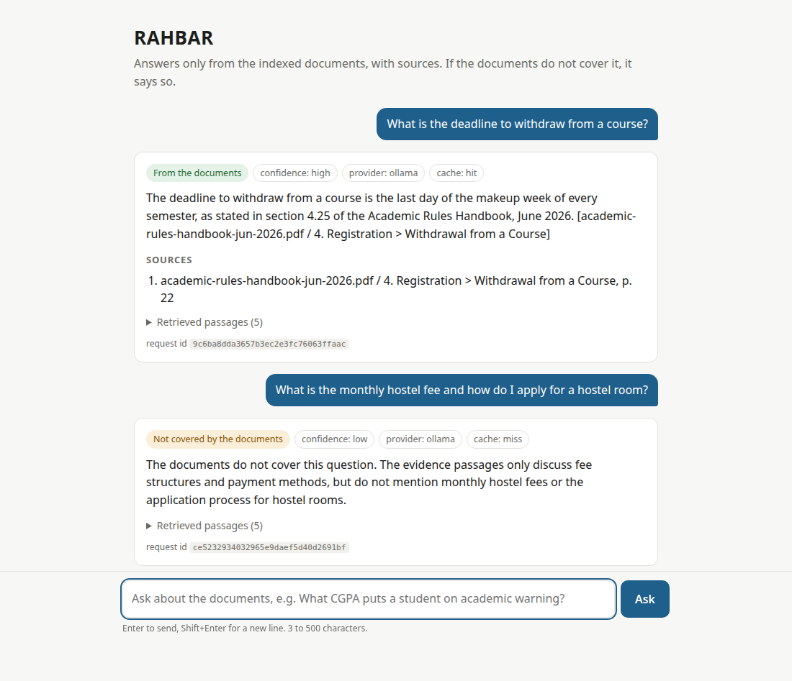
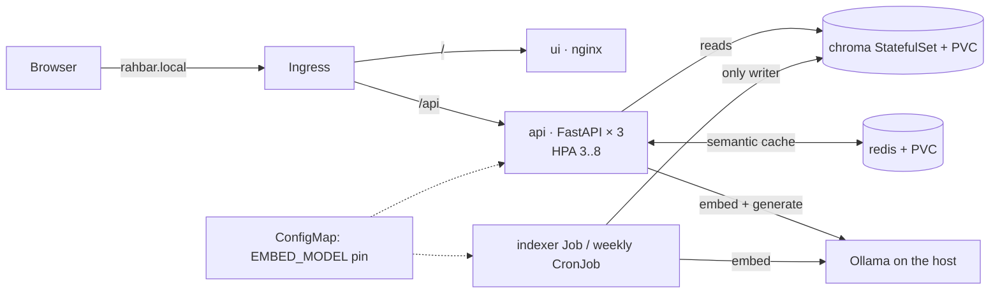

# RAHBAR: grounded answers about FAST-NUCES rules, on Kubernetes

[](https://github.com/IfBilal/Rahbar/actions/workflows/ci.yml)
[](https://github.com/IfBilal/Rahbar/actions/workflows/cd.yml)

A student wants to know whether they can still withdraw from a course. The answer is in
clause 4.25 of a PDF on the university website, and an older edition of the same rules,
with a different deadline, is still online next to it. A general chatbot answers
confidently from some other university's rules. **RAHBAR answers only from FAST-NUCES's
own public documents.** It quotes the current edition unless you ask about the old one,
cites the source, section and page of every claim, and says plainly when its documents do
not cover a question (try asking about hostel fees). It runs on Kubernetes: an indexing Job
builds the vector index, three read-only API replicas serve questions, and a CI gate fails
the build when retrieval quality drops.

Assignment 02, CS4032 · Team: Taimoor Shaukat (24I-3015), Muhammad Bilal Tahir (24I-3166)



## Architecture



The indexer is a **Job**, never part of API startup (`docs/adr/0001-indexer-as-job.md`).
Each run writes a new index *generation* and then flips a pointer, so re-indexing happens
while the API keeps serving. The API reads, checks that the index was built with the same
embedding model (`EMBED_MODEL`), and stays out of the Service (`0/1 READY`) until it was.
Full design: `docs/ARCHITECTURE.md`.

| Measured on our stack | Value | Where |
| --- | --- | --- |
| Corpus | 9 public documents, 279 PDF pages + 2 web pages, 532 chunks | `docs/CORPUS.md` |
| recall@3 / recall@5 (19-question golden set) | 0.969 / 0.969 (ordinary 1.0, version 1.0, exact terms 0.833) | `eval/results.json` |
| Citation validity / must-abstain correctness | 100% / 100%; all 16 answerable answers correct on review (q09 fixed by the numeric table assist) | `eval/results.json`, `docs/PIPELINE.md` |
| Chunking shipped | 300 tokens, 40 overlap (best recall@3 of three measured settings) | `docs/PIPELINE.md` |
| Semantic cache threshold | 0.95, the lowest with zero false hits | `docs/evidence/cache-threshold.txt` |
| Indexer peak memory | 910 Mi (limit 1536 Mi) | `docs/evidence/kubectl-top-indexer-run.txt` |

## From a clean clone to an answered question

Tested on Ubuntu 24.04 with Docker, minikube v1.39, kubectl, kustomize and Ollama. On
macOS or Windows with the docker driver, run `minikube tunnel` and use `127.0.0.1` where
this guide says `$(minikube ip)`.

```bash
git clone https://github.com/IfBilal/Rahbar.git && cd Rahbar
make install                         # .venv with the api, indexer and test dependencies
make test                            # 250+ tests, no cluster, no model, no network

# 1. A cluster whose network plugin enforces NetworkPolicy (Calico), plus ingress and metrics
make cluster        # minikube start --driver=docker --cni=calico --memory=6144 --cpus=4
                    # minikube addons enable metrics-server ; minikube addons enable ingress

# 2. The models, on the laptop (ollama-host mode). Ollama must listen where pods can reach it.
ollama pull llama3.2:3b && ollama pull nomic-embed-text
OLLAMA_HOST=0.0.0.0 ollama serve     # or, in another terminal: make ollama-host

# 3. Images: build api, ui and indexer locally and load them into minikube
make images                          # TAG=dev

# 4. Apply (one command, see the order below), then wait for the index and the rollout
kubectl apply -k k8s/overlays/dev
kubectl wait --for=condition=complete job/indexer -n rahbar --timeout=40m
kubectl rollout status deployment/api -n rahbar

# 5. Ask through the Ingress
make ask Q="What is the deadline to withdraw from a course?"
make ask Q="What is the monthly hostel fee?"             # declines: not in the corpus
# or open the chat UI: add "$(minikube ip) rahbar.local" to /etc/hosts, browse http://rahbar.local
```

**Bonus: Ollama inside the cluster.** `kubectl apply -k k8s/overlays/incluster`, then
`kubectl rollout restart deployment/api -n rahbar`. This adds an Ollama Deployment with
a PVC for the weights; its init container pulls both models once, and its startupProbe
allows 30 × 10 s for loading. It switches `LLM_PROVIDER` to `ollama-incluster` and points
the API and the indexer at `http://ollama:11434` through NetworkPolicy. Verified on
minikube (`docs/evidence/ollama-incluster.txt`). The case study recommends
`--memory=8192` for this mode.

**Embeddings go through the same host Ollama.** In ollama-host mode both the indexer Job
and the API call `http://host.minikube.internal:11434` for `nomic-embed-text` embeddings as
well as `llama3.2:3b` generation; the model is pinned by `EMBED_MODEL` in the ConfigMap.

The first indexer run takes about 10 minutes on a laptop CPU: it downloads the corpus,
OCRs 32 scanned pages and embeds 532 chunks (the clean-clone run took 7 minutes,
`docs/evidence/clean-clone.txt`). Until it finishes, the API pods correctly
report `0/1 READY`.

### The apply order

`kubectl apply -k k8s/overlays/dev` renders `k8s/base` and applies it in a safe order:
kubectl creates the Namespace first, and every workload waits on what it needs through its
probes. Applied file by file, the equivalent order is:

```bash
kubectl apply -f k8s/base/namespace.yaml
kubectl apply -f k8s/base/serviceaccounts.yaml -f k8s/base/configmap.yaml
# hosted LLM only; never from a file:
#   kubectl create secret generic rahbar-secret -n rahbar --from-literal=LLM_API_KEY="$LLM_API_KEY"
kubectl apply -f k8s/base/networkpolicy.yaml -f k8s/base/services.yaml
kubectl apply -f k8s/base/chroma-statefulset.yaml -f k8s/base/redis.yaml
kubectl apply -f k8s/base/indexer-job.yaml -f k8s/base/reindex-cronjob.yaml
kubectl apply -f k8s/base/api.yaml -f k8s/base/ui.yaml -f k8s/base/hpa.yaml -f k8s/base/ingress.yaml
```

(The dev overlay also pins the local image tags; applying `k8s/base` by hand needs
`kubectl set image` or the overlay.)

### Common operations

| Task | Command |
| --- | --- |
| Re-index now, no redeploy | `kubectl create job --from=cronjob/reindex manual-reindex-1 -n rahbar` (or `make index`) |
| Change the Job's template | `kubectl delete job indexer -n rahbar` first: a Job's pod template is immutable |
| Evaluate through the Ingress | `make eval` (writes `eval/results.json`, exits 1 if the gate fails) |
| Smoke test | `python3 scripts/smoke.py --api http://$(minikube ip)` |
| Live system checks | `make system-test` (pin, policy, abstention, pod deletion) |
| Hosted LLM key | `export LLM_API_KEY=...; make secret` |
| Ollama not on 192.168.49.1 | `minikube ssh "grep host.minikube.internal /etc/hosts"`; if it differs, change the two `ipBlock` entries in `k8s/base/networkpolicy.yaml` |

## API

| Method | Path | Purpose |
| --- | --- | --- |
| POST | `/api/ask` | `{"question": "..."}` (3–500 chars) → answer, citations, `answered_from_context`, confidence, retrieved passages with scores, provider, `cached`. 422 on a bad question. |
| GET | `/healthz` | Liveness: the process is alive. Touches nothing else. |
| GET | `/readyz` | Readiness: Chroma reachable, active collection non-empty, its embedding model equal to `EMBED_MODEL`, Redis reachable. 503 names the failed check. |
| GET | `/metrics` | Prometheus: requests and latency per route, retrieval and generation latency, cache lookups/hits/ratio, abstentions, fallbacks, tokens in/out per request. |

Every response carries `X-Request-ID` (yours, or generated), and every log line for that
request carries the same id.

## Corpus

Nine public FAST-NUCES documents: the June 2026 Academic Rules Handbook and the August 2023
edition it superseded, the 2026 Prospectus rules, the Student Handbook, two annual reports,
the fee and grading web pages, and a scanned ORIC policy. **We do not commit the documents.**
`corpus/MANIFEST.md` records each URL and SHA-256, and `corpus/fetch.py` downloads them.
The indexer Job runs that fetch at start-up and refuses bytes that differ from the manifest.
Hostel rules are deliberately absent. Details: `docs/CORPUS.md`.

## Repository map

```
api/        FastAPI service: reads the index, never writes it   (Dockerfile, tests/)
indexer/    the Job's image: extract, clean, chunk, embed, store (Dockerfile, tests/)
ui/         chat page served by nginx                            (Dockerfile, nginx.conf)
corpus/     fetch.py, sources.yaml, MANIFEST.md (no documents)
eval/       golden.yaml (19 questions), run_eval.py, baseline.json, results.json, fixtures/
k8s/        base/, overlays/{dev,prod,ci}/, components/ephemeral-cluster/
tests/      architecture tests over rendered manifests and code boundaries; system/ live checks
scripts/    check_submission.py, e2e-kind.sh, smoke.py, chunk-sweep.sh, cache_threshold.py
docs/       CORPUS, PIPELINE, FAILURE-ANALYSIS, ENGINEERING-NOTES, AI-USAGE, ARCHITECTURE,
            adr/0001..0004, evidence/, TRACEABILITY
.github/    workflows/ci.yml (lint, test, manifests, build, scan, e2e-eval), cd.yml
```

## CI/CD

`ci.yml` runs on every pull request to `main` and every push to `dev`: ruff and mypy;
pytest with ≥ 60% coverage on stubs (we are at 96%); `kustomize build | kubeconform
-strict`; image builds (never pushed); Trivy failing on fixable HIGH/CRITICAL; and
**e2e-eval**, which builds a kind cluster, deploys everything, runs the indexer Job on the
fixture corpus with the real embedding and generation models, and enforces the evaluation gate (recall@5
within 5 points of `eval/fixtures/baseline.fixture.json`, every must-abstain question
declined, ≥ 95% citation validity, and no answer repeating the planted instruction in
the fixture's poisoned chunk).

`cd.yml` runs on every push to `main`: test → build and push the three images to Docker
Hub tagged with the commit SHA (`needs: test`) → deploy them to an ephemeral kind cluster
with the real corpus and the real model (`llama3.2:3b` on the runner, ollama-host mode),
wait for `rollout status`, and smoke-test through the Ingress: a cited answer and a declined
absent topic (`needs: build-push`). The first run (41967840446) deployed and served but
failed the smoke test: it still generated with the CI stub, which cannot decline a topic
whose passages clear the relevance floor. The deploy now uses the real model. It deploys by SHA, never `:latest`. It needs the repository secrets
`DOCKERHUB_USERNAME` and `DOCKERHUB_TOKEN` (an access token, not a password).

`main` is protected: pull request, passing CI and one approval. Work happens on `dev`.
One commit reached `main` before protection existed: `f0f080c`, the planning pack, pushed on
the first day. Every change since then has gone through a reviewed pull request.

## Documents

| File | What it answers |
| --- | --- |
| `docs/CORPUS.md` | The seven corpus properties, document by document |
| `docs/PIPELINE.md` | Extraction, cleaning, chunking (three measured settings), embedding pin, cache threshold, evaluation method |
| `docs/FAILURE-ANALYSIS.md` | Stages broken on purpose, one at a time, and how each shows up |
| `docs/ENGINEERING-NOTES.md` | The seven engineering questions, with file and line references |
| `docs/adr/` | Indexer as a Job; chunking; cache store; provider and data governance |
| `docs/AI-USAGE.md` | Which AI tools we used, for what, and what we changed |
| `docs/TRACEABILITY.md` | Every requirement in the case study → code → test → evidence |
