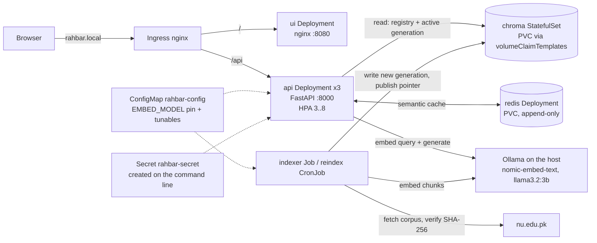

# RAHBAR architecture (as built)

RAHBAR answers questions about FAST-NUCES academic rules from a fixed corpus of public
documents, cites the passages it used, and declines when the corpus does not cover the
question. It runs on Kubernetes as two paths that never share a process: an **indexer**
that writes the vector store when the documents change, and an **API** that only reads it
on every question.

> Planning history: this file replaces the pre-implementation plan that was here. The
> decisions are recorded in `docs/adr/0001`–`0004`; the measurements behind every tuned
> number are in `docs/PIPELINE.md`.

## Components and data flow

| Object | Kind | Why it is this kind |
| --- | --- | --- |
| `api` | Deployment, 3 replicas, HPA 3–8 | Stateless readers; interchangeable pods behind one Service |
| `ui` | Deployment, 1 replica | Static files; nginx as uid 101, read-only root |
| `chroma` | **StatefulSet**, 1 replica, `volumeClaimTemplates` | See below |
| `redis` | Deployment + PVC `redis-data`, `Recreate` | One pod owns the cache volume; append-only file survives restarts |
| `indexer` | Job | Runs once, writes, exits (ADR 0001) |
| `reindex` | CronJob, Sundays 03:00, `Forbid` | Same pod template as the Job; never two writers |
| `api`, `ui`, `chroma`, `redis` | Service, ClusterIP | Only the Ingress is reachable from outside |
| `rahbar` | Ingress | One host: `/` to ui, `/api` to api, unchanged |
| `rahbar-config` | ConfigMap | Every tunable and the embedding pin, read by api and indexer |
| 7 policies | NetworkPolicy | Default deny, then the graph below |

### Why Chroma is a StatefulSet, not a Deployment

Chroma is the one component whose identity is its data. A StatefulSet gives the pod a
stable name (`chroma-0`) and, through `volumeClaimTemplates`, a PersistentVolumeClaim
(`data-chroma-0`) that belongs to that identity. When `chroma-0` is deleted, rescheduled or
upgraded, its replacement is again `chroma-0` and re-attaches the **same** volume, so the
index survives. The StatefulSet also never runs two copies of `chroma-0` at once, which
matters because Chroma's SQLite and HNSW files support one writer process.

A Deployment gives the opposite guarantees. Pods get random names and are interchangeable.
A rolling update starts the new pod *before* the old one stops, so with a ReadWriteOnce
volume the new pod either cannot mount it and hangs in `ContainerCreating`, or, on storage
that allows it, two Chroma processes open the same files. Without a claim the index lives in
the container's filesystem and disappears with the pod. A Deployment fits the API (any copy
is as good as another); it does not fit the store. Redis has its own PVC as a single-replica
Deployment with `strategy: Recreate`, which avoids the overlap for the one cache pod.

## The query path (every question)

`POST /api/ask` → `api/app/services/answer.py`:

1. **Validate**: 3–500 characters (`AskRequest`), else 422.
2. **Cache**: skip follow-ups; otherwise embed the question and look for a stored answer
   with cosine ≥ `CACHE_THRESHOLD` in this generation's scope (ADR 0003).
3. **Embed** with the pinned model, using the same prefix and casing as the indexer.
4. **Retrieve** top `TOP_K` from the active generation, `superseded == false` unless the
   question asks about an older version, with clause numbers and course codes pulled
   forward by Chroma's full-text `$contains` (exact-term assist).
   **Floor**: if no passage reaches `RELEVANCE_FLOOR`, abstain without calling the model.
5. **Augment**: system rules, then up to `MAX_CONTEXT_PASSAGES` enumerated `<evidence>` (ids A, B, C, so they never collide with clause numbers)
   blocks (untrusted data, with imperatives neutralised), then the `<question>`.
6. **Generate**: Ollama with `format` = the `Answer` JSON schema, temperature 0.2.
7. **Validate**: Pydantic, then the citation guard; one retry with the reason; then a
   canned answer. Never a 500.
8. **Store**: one JSON log line (top_k, chunk ids, scores, abstained, cached, latencies,
   tokens); cache the answer only if it is grounded and validated.

## The indexing path (when the documents change)

`python -m pipeline.run` in the Job: init container `fetch-corpus` downloads the committed
source list and fails closed if any SHA-256 differs from `corpus/MANIFEST.md`; then
extract (pdfplumber, Tesseract OCR for pages without a text layer, tables as rows) →
clean → structure-aware chunk → embed (batched, checked) → store a new generation →
publish the registry pointer → garbage-collect older generations (keep active and previous).

## Network graph (default deny)

| From | To | Port | Policy |
| --- | --- | --- | --- |
| ingress-nginx namespace | ui | 8080 | `ui-from-ingress` |
| ingress-nginx namespace, ui | api | 8000 | `api-policy` |
| api | chroma, redis, Ollama host | 8000, 6379, 11434 | `api-policy` (egress) |
| indexer | chroma, Ollama host, public web | 8000, 11434, 443/80 | `indexer-policy` |
| api, indexer | chroma | 8000 | `chroma-from-api-and-indexer` |
| api | redis | 6379 | `redis-from-api` |
| every pod | kube-dns | 53 UDP/TCP | `allow-dns-egress` |
| **ui** | **chroma** | 8000 | **nothing allows it: denied** |

Verified on minikube with Calico (`docs/evidence/networkpolicy-tests.txt`).

## Failure domains, as observed

| Failure | What happens | Why |
| --- | --- | --- |
| One api pod deleted | Service keeps answering from the other two; the Deployment replaces it | 3 replicas, readiness gates traffic |
| Chroma down or slow | api pods go 0/1 READY (503 names `chroma`), are **not** restarted; recover by themselves | `/readyz` checks Chroma; `/healthz` touches nothing; Chroma calls time out after 5 s |
| No index yet / empty collection | api pods stay 0/1 READY | `/readyz` requires a non-empty collection |
| `EMBED_MODEL` changed on the API only | api pods 0/1 READY with a log line naming both models | the pin check (ADR 0004) |
| Indexer dies half-way | old generation keeps serving; the half-written one is never published | registry pointer moves only after a full count check |
| Website publishes new bytes | indexer Job fails closed; old generation keeps serving | manifest SHA-256 check |
| Redis down | api pods 0/1 READY (case study requires it); requests in flight answer without cache | readiness vs request-path handling |
| Model returns prose or fake citations | one retry, then a canned answer; `rahbar_fallbacks_total` increments | guard + fallback |

## Security closures (section 4.7)

| Hole | Closure here |
| --- | --- |
| Secrets in Git | `*secret*.yaml` gitignored; `k8s/base/secret.placeholder.yaml` holds `REPLACE_ME` only and is not in `kustomization.yaml`; the key is created with `kubectl create secret` (`make secret`) |
| Everything is admin | One ServiceAccount per workload, `automountServiceAccountToken: false` everywhere (nothing calls the API server) |
| Containers as root | `runAsNonRoot`, numeric users, `readOnlyRootFilesystem: true`, `capabilities.drop: [ALL]`, `allowPrivilegeEscalation: false`, `seccompProfile: RuntimeDefault`; writable paths are emptyDirs and PVCs |
| Flat network | NetworkPolicy deny-by-default plus the graph above; Calico enforces it |
| Unsafe model output | Schema-constrained and validated; citations checked against retrieved chunks; never passed to `eval`, never used to build a query |
