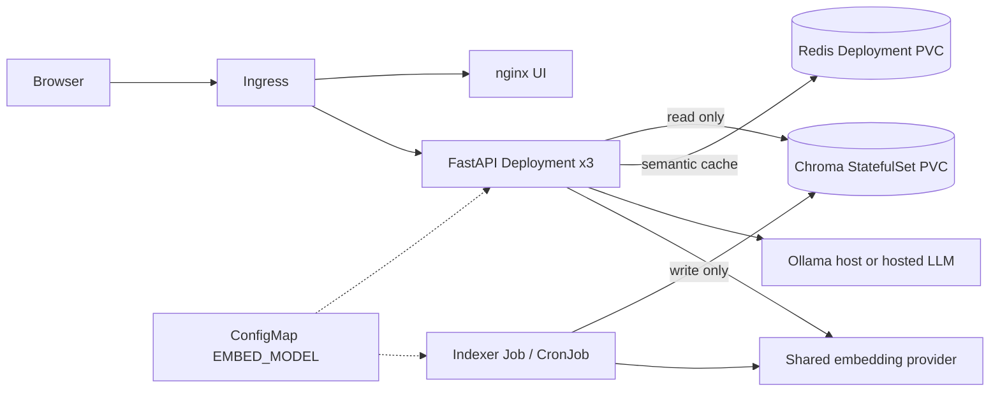
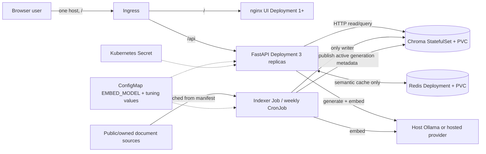

# System architecture, data ownership and sequences

**Architecture at a glance:** Browser → Ingress (`/` UI, `/api` API) → three read-only FastAPI replicas → Chroma StatefulSet (PVC), Redis Deployment (PVC) and chosen LLM provider. A separate one-shot Job and weekly CronJob perform document extraction, chunking and embedding, then write to Chroma. All objects live in namespace `rahbar`. **Only the indexer writes corpus vectors.**



**Safety constraint for live re-indexing:** a staging/publish mechanism is a proposed implementation detail, not present in the starter; verify atomic cutover on the selected Chroma version and do not destructively replace the active collection in production. Review ADR 0003 before implementation.

---

<!-- This file consolidates related plans. Any unchecked boxes, MEASURE placeholders or example values require actual implementation and evidence. -->

<a id="merged-docs-07-architecture-md"></a>

## System architecture — deployed target


> **Target architecture, not as-built evidence.** See `AGENTS.md` for current starter state. This document defines concrete separation, data flow, resource ownership and planned failure handling.

### Context / container diagram


### Kubernetes layout
- Namespace: `rahbar`, never `default`.
- API: `Deployment` replicas=3, startup/liveness/readiness, requests/limits, rolling update maxSurge=1/maxUnavailable=0, preStop and grace period; CPU HPA min=3/max=8.
- UI: nginx `Deployment` port 8080 and ClusterIP service; static supplied UI, same origin Ingress routes `/` vs `/api`.
- Chroma: `StatefulSet` replicas=1, `volumeClaimTemplates`, matching `chromadb/chroma:1.0.12`, ClusterIP only. Chroma state must outlive pod recreation.
- Redis: persistent `Deployment`+PVC, ClusterIP only, AOF (plus readiness). It holds eligible cached answers; the active collection pointer remains in Chroma registry metadata (safe-reindex design (consolidated in ADR 0003)).
- Indexer: `Job` restartPolicy=OnFailure/backoffLimit set, weekly `CronJob` using same image/args, isolated ServiceAccount; single-writer safety lock against overlapping jobs.
- 4 Services: UI, API, Chroma, Redis. Ingress single host `rahbar.local` using minikube addon, not external access to data stores.
- ConfigMap and Secret; service accounts and default-deny NetworkPolicy with narrow allowed ingress/egress (including DNS and Ollama host).

### Indexing boundary
The API **never** extracts documents, chunks, writes vectors or starts indexing during lifespan. The indexer does: discover/fetch -> extract (OCR if needed) -> clean -> structure-aware chunk -> embed with pinned model -> store and metadata -> publish ready index -> invalidate old cache entries. The Job exits. Running the CronJob again does not require an API image change or redeployment.

### Query boundary
`POST /api/ask` -> validate -> identify whether conversation/follow-up (the starter schema has only a question; see constraint below) -> eligible cache lookup -> embed -> active collection retrieval using Chroma HTTP + exclude superseded except explicit historical question -> relevance floor -> prompt from numbered passages -> schema-constrained provider output -> Pydantic validation/retry once -> citation matching -> abstain/safe fallback when necessary -> log/metrics -> optionally cache and return `AskResponse`.

### Conversation limitation (important)
The provided `AskRequest` has **only `question`**, no session/history. Therefore do **not invent follow-up state**. Safe baseline: **disable caching for any question detected as follow-up/ambiguous** (conservative heuristic); do not claim full multi-turn context support. Changing request schema for conversation IDs requires a reviewed contract ADR.

### Deployment failure domains
- One API pod dies: Service continues via other ready endpoints; HPA retains at least 3 desired replicas.
- Chroma slow/unreachable: `/readyz` returns 503; `/healthz` remains 200; no dependency-induced restart storm.
- Redis unavailable: per assignment `/readyz` fails; no stale cache fallback; recovery preserves PVC. Optionally bypass cache at application level only if readiness semantics are explicitly preserved.
- Model mismatch: API checks active collection metadata `embed_model` and `dimension`; mismatch blocks readiness with precise log.
- Reindex failure: never publish a partial collection; old active collection still serves until successful cutover.
- Redis cache contains outdated content: after a verified Chroma registry generation switch, API readers never reuse previous-generation cache keys. Atomicity must be demonstrated.

### Trust boundaries
Questions and retrieved documents may contain instructions but are **data**. System instructions dominate. Enforce Pydantic `Answer` schema; whitelist citations against request retrieved passages; strip `reasoning`; never use `eval` or run text as code. Secret values only from Kubernetes Secret, never logs/manifests. Use non-root read-only root filesystems and tight NetworkPolicy.

### Choices and evidence
See the four consolidated ADRs in `ADR-0001-indexer-as-job.md` through `ADR-0004-llm-provider-and-data-governance.md` for decisions and `PRD.md` for the code/test/evidence that must prove each design. If versioned publish exceeds the assignment timeline, document a tested alternate zero-downtime strategy **before** switching; no destructive rebuild of the only live collection while serving traffic.

---

<a id="merged-docs-09-data-model-and-metadata-md"></a>

## Data model and metadata lineage


### Entities and source of truth
**Source descriptor** (`corpus/sources.yaml`): name, public URL, version, superseded flag. `corpus/fetch.py` writes SHA-256 to `corpus/MANIFEST.md` and file metadata to `corpus/raw/_index.json`; those are inputs to `indexer/pipeline/run.py::discover`. This metadata is not determined by an LLM.

**Page** (`indexer/pipeline/models.py`): `source: str`, `page: int` (one-based), `text: str`, `ocr: bool`. An OCR page remains linked to its exact page number. **Document**: `source`, `doc_version`, `superseded`, `pages`.

**Chunk**: `id`, `text`, `source`, `section`, `page`, `doc_version`, `superseded`. Required metadata shown in `Chunk.metadata()`; optional suggested fields: `sha256`, `start_offset`, `end_offset`, `corpus_generation`, `extraction_method`. Only add fields after tests and alignment with Chroma value types.

**Vector collection**: stored `(id, document, embedding, metadata)`. Collection-level metadata `embed_model` and `dimension` must be actual values from the model response, not guessed; set Chroma metric `hnsw:space=cosine` if compatible with selected server. Use stable chunk ID based on source digest + version + section/page + ordinal/content hash to avoid accidental cross-document overwrites.

**Golden question** (`eval/golden.yaml`): `id`, `type`, `question`, `relevant: [{source,section}]`, optional `expect`, `must_abstain`. Labels are authored from documents **before retrieval tuning**, never reverse-engineered from returned chunks. Citation validation is a separate metric from answer factual correctness.

### Identity/integrity rules
1. Do not rename a source between fetch, chunk, golden reference, and `AskResponse`: doing so breaks recall/citation matching.
2. `doc_version` reflects source revision, `superseded` reflects applicability—not file creation timestamp. A report from 2020 is **not** automatically superseded by a report from 2024; for same-topic policy revisions mark the old policy true.
3. On a current-policy query filter `superseded=false`. A clearly historical query can request older versions; test explicit intent parsing to avoid silent version leakage.
4. Never use document text as an index metadata key (large/untrusted). Never store user secrets in Chroma/Redis/logs.
5. Empty extraction/text pages need per-file logs; total page count includes scanned pages, while measured indexed page count should be reported separately.

### Logical active index (proposed safe-reindex design (consolidated in ADR 0003))
New index generation has a unique Chroma collection (for example `rahbar__g_<shortdigest>`) and metadata (`embed_model`, `dimension`, `generation`). Only after write + count + smoke retrieval does the indexer update an internal **Chroma registry control collection** metadata with active collection name and generation. The API reads the Chroma active pointer and scopes Redis cache keys by generation, purging/expiring old keys on observed switch. This preserves the rubric NetworkPolicy: **only API accesses Redis**, never indexer. The old collection is retained for rollback until the next verified publish. Atomicity of the Chroma metadata update requires live testing. This is a proposal, not implemented in starter.

### Failure prevention
Partial writes must not become active. Changing EMBED_MODEL without rebuilding the vectors must leave API unready. Delete/corpus-change semantics require a new generation so removed documents cannot remain retrievable. Test zero-chunk index, incorrect vector dimension, missing section metadata, changed source URL, duplicate chunks, and false `superseded` flags.

---

<a id="merged-docs-10-sequences-md"></a>

## Sequence diagrams and contract touchpoints


### Query (normal, cache hit, fallback)
```mermaid
sequenceDiagram
  participant U as Browser
  participant A as FastAPI
  participant R as Redis
  participant C as Chroma
  participant O as Embed/LLM provider
  U->>A: POST /api/ask(question)
  A->>A: Validate 3..500; request_id
  A->>C: Resolve active index and generation from registry
  opt cache-eligible exact/semantic match
    A->>R: Cache lookup within same generation
    R-->>A: Validated previous answer
    A-->>U: AskResponse (cache hit)
  end
  A->>O: Embed question (pinned EMBED_MODEL)
  O-->>A: Query vector
  A->>C: top_k with superseded policy
  C-->>A: Passages + cosine distances
  A->>A: Convert to similarity and relevance floor
  alt no grounded evidence
    A-->>U: Answered_from_context=false; no fabricated citations
  else grounded evidence
    A->>O: System rules + numbered context + question + JSON schema
    O-->>A: Candidate Answer
    A->>A: Validate, retry once, citation whitelist, safe fallback
    opt safe eligible answer
      A->>R: Cache only with current index generation
    end
    A-->>U: AskResponse (no reasoning field)
  end
```

### Indexing / publication
```mermaid
sequenceDiagram
  participant J as Indexer Job
  participant S as Document source or mounted corpus
  participant O as Embedding provider
  participant C as Chroma
  participant R as Redis
  participant A as API (3 replicas)
  J->>J: Ensure no overlapping Job (CronJob Forbid; operator checks manual Jobs)
  J->>S: Fetch/verify or read corpus
  J->>J: Extract/OCR -> clean -> chunk
  J->>O: Embed batches with pinned model
  O-->>J: Vectors with observed dimension
  J->>C: Create staging collection and add chunks
  J->>C: Verify count and model metadata
  J->>C: Publish active pointer in Chroma registry (verify atomicity)
  A->>C: Resolve active collection for next request
  A->>C: Read new active collection
  A->>R: Purge/expire old-generation cache keys
```

### Kubernetes readiness, deploy and failure
```mermaid
sequenceDiagram
  participant K as Kubelet
  participant A as API pod
  participant C as Chroma
  participant R as Redis
  K->>A: GET /healthz
  A-->>K: 200 (process only)
  K->>A: GET /readyz
  A->>C: heartbeat, collection count + metadata
  A->>R: PING Redis semantic cache
  alt all checks good
    A-->>K: 200; include in Service endpoints
  else missing / wrong pin / dependency down
    A-->>K: 503; remove from endpoints (do not restart due to liveness)
  end
```

### Integration obligations
A owns generation and index semantics; B owns probe/manifest rollout. At G3 validate that B's probe reads the *same active collection* as A's retriever, and that B's NetworkPolicy allows both dependencies. At G5 validate cache generation invalidation against a real reindex and ensure a stale cached answer cannot be served.

---

