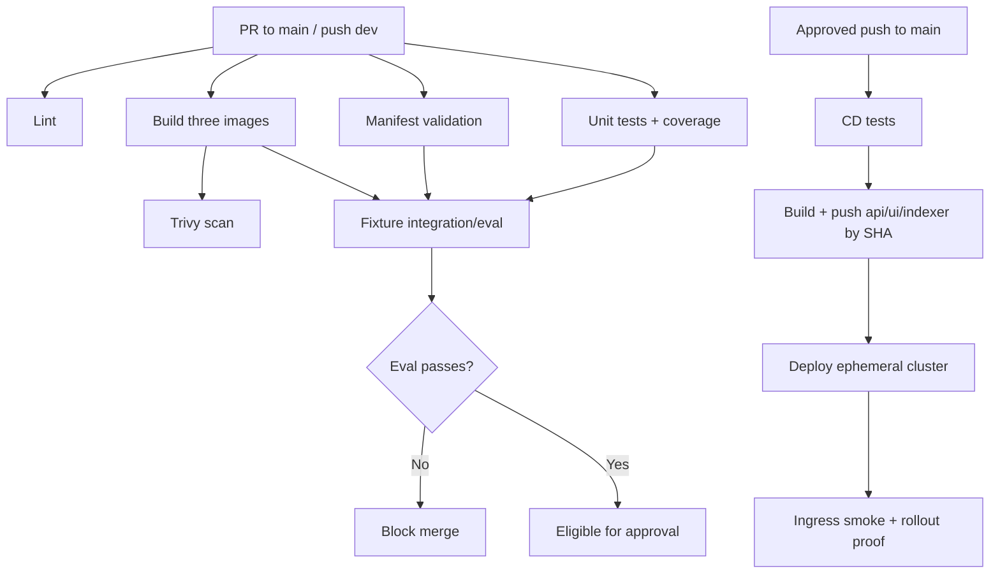

> **Status (5 November 2026):** implemented as `.github/workflows/ci.yml` and `cd.yml`; gate shown red then green in `docs/evidence/gate-demo.txt`. This guide is kept as the plan of record.

# GitHub Actions CI/CD execution and quality gates

**Branches:** `dev` for integration, protected `main` (no direct pushes; require passing CI and one approving reviewer). `ci.yml` on PRs to `main` and pushes to `dev`; jobs `lint`, `test` (≥60% app coverage, stubs/offline), `manifests` (`kustomize build` | `kubeconform -strict`), `build` (API/UI/indexer, no PR push), `scan` (Trivy fixed HIGH/CRITICAL), `e2e-eval` (kind/k3d + real fixture indexing + evaluation quality gate).

**`cd.yml`:** on push to `main`: test → `build-push` (Docker Hub `github.sha`) → `deploy` into ephemeral cluster (rollout status + Ingress smoke); enforce `needs:` on publishing/deploying jobs; least-privilege workflow permissions; credentials only via GitHub Secrets. A screenshot of intentionally failing evaluation PR *and then passing* is required. No `:latest` deployments.

## Concrete workflow dependency and proof design

**Suggested CI sequence, not an asserted existing workflow:**
1. Configure PR/main and push/dev events, `permissions: contents: read` by default, concurrency cancellation per branch; branch protection requires CI and one human approval.
2. `lint`: set up Python 3.12, pip install explicit dependencies, Ruff and Mypy; UI TypeScript/ESLint only if the supplied plain HTML UI is changed into a build system.
3. `test`: stub LLM/retriever and mock HTTP, run pytest and coverage for `api/app` at ≥60%. Tests must run offline, including negative citation, poisoned text, health and config.
4. `manifests`: `kustomize build k8s/overlays/prod | kubeconform -strict -summary` with failure propagated through `set -o pipefail`; validate every required object and namespace.
5. `build`: Docker build all three images, no registry push on unapproved PR. Use digest-pinned tooling and image tag from ref/SHA, not mutable `latest`.
6. `scan`: Trivy fail on HIGH/CRITICAL vulnerabilities with available fixes (configure scanner to match rubric); store scan reports if possible.
7. `e2e-eval`: provision kind or k3d, deploy fixture Chroma/Redis, make fixture documents accessible inside indexer, use a deterministic **matching** embedding method for index and query, run real fixture Job, then launch API and route requests. `eval/run_eval.py --golden eval/fixtures/golden.fixture.yaml ...` must exit nonzero on regression. A stub API returning canned answers is insufficient.
8. Demonstrate gate enforcement: deliberately introduce a test failure or must-abstain regression in a PR, show merge blocked, fix and show green again. Capture actual URLs/screenshots only after running.

**CD requirements:** `test` job → `build-push` with `needs: [test]` → `deploy` with `needs: [build-push]`, Docker Hub access token stored as a GitHub Secret (not Docker Hub password). Tag three published images with full `${{ github.sha }}` (this literal is GitHub Actions syntax) and set those tags in the ephemeral deployment. Wait for all three API pods Ready, `kubectl rollout status`, then curl Ingress with a known fixture question and report both HTTP status and citation validity.

**Important caveats:** a GitHub-hosted ephemeral cluster cannot reach *your laptop's* host Ollama, so its fixture evaluation must use an explicitly test-only deterministic embedder and stub/controlled model provider or a reachable hosted test provider. Make the test path explicit in configs and never claim it tests production LLM factuality. In CI, policy enforcement, ingress controller setup, local image loading, storage provisioning and pod readiness need real `kubectl` wait steps. CD should not contain a deploy job with no `needs:` just because an initial prototype uses dummy data.

---

<!-- This file consolidates related plans. Any unchecked boxes, MEASURE placeholders or example values require actual implementation and evidence. -->

## CI/CD build and release protocol

### Requirements
Follow assignment section 6 exactly: `ci.yml` on PR to `main` and push to `dev`; `cd.yml` on push to protected `main`. Re-run CI gates on release PR and prevent direct pushes. Every publishing/deploying job requires `needs` on successful upstream tests/builds.

### CI stages
1. `lint`: Python ruff+mypy, UI lint if actual build step.
2. `test`: pytest with no external model, stub provider and `>=60%` app coverage.
3. `manifests`: `kustomize build k8s/overlays/prod | kubeconform -strict`.
4. `build`: build API, UI, indexer; no PR pushes.
5. `scan`: Trivy fail HIGH/CRITICAL with fix available.
6. `e2e-eval`: kind or k3d ephemeral cluster, same pinned Chroma/Redis images, fixtures actually indexed, Ingress+API readiness, `eval/run_eval.py` gate.

### CD stages
`test` -> `build-push` (needs test; Docker Hub token from GitHub Secrets; tag **commit SHA**) -> `deploy` (needs build-push; ephemeral cluster, `kubectl rollout status`, Ingress smoke). Production overlay must use SHA images, not `:latest`; commit SHA should correspond to `git show`.

### Evidence checklist
- Both successful CI/CD run URLs and SHA image links accessible to grader.
- Protected branch screenshot one review + required checks.
- Intentional regression PR with blocked merge screenshot, fixed green screenshot.
- Actual fixture evaluation results and real corpus baseline results distinguished.
- Trace tags: `docker inspect`/`kubectl get deployments -o jsonpath` show SHA rather than floating tag.

### Security
GitHub Action permissions least privilege; no registry token echo; no real Secret manifest; no manual bypass if CI fails; avoid exposing Github secrets to untrusted PRs. For vulnerability findings, fix or document inability—do not silently `continue-on-error` on required security gate.

---

## Implementation spec — Ci Cd

**Owner:** B. **WBS:** T17,T18,T19. **Primary paths:** `/.github/workflows/ci.yml; /.github/workflows/cd.yml; k8s/overlays/prod/*`. **Status:** target implementation design; run tests to verify. **Source authority:** assignment PDF + STARTER.md + existing starter signatures.

### CI triggers and jobs
`ci.yml`: PR into `main`, push to `dev`. Lint (`ruff`, `mypy`, eslint/tsc only if UI build used), pytest with >=60% app package coverage and stub provider/no network, `kustomize build k8s/overlays/prod | kubeconform -strict`, Docker build 3 images (no PR push), Trivy scan failing HIGH/CRITICAL with fix available, `e2e-eval` ephemeral kind/k3d cluster running **fixture indexer Job** and golden eval gate.

### CD triggers and jobs
`cd.yml`: push to protected `main`; **test** job -> **build-push** job (`needs: test`) pushes Docker Hub api/ui/indexer images tagged `${{ github.sha }}` -> **deploy** job (`needs: build-push`) provisions ephemeral cluster, kustomize applies SHA images, runs indexing or uses confirmed persistent fixture data, `kubectl rollout status`, and smoke tests `/api/ask` through Ingress. Do not attempt public production cloud deploy unless assigned.

### Secure workflow design
Permissions least privilege; Docker Hub token via GitHub Actions Secrets, never password in YAML/log; protect `main` with one human review + passing CI. Use `needs:` for all publication/deployment jobs, never deploy `latest`. Preserve failed/green PR screenshot evidence. Inspect image tag through `kubectl get deployment ... -o jsonpath=...` and compare git SHA.

### Failure checks
Deliberately lower recall or break a fixture retrieved section in a PR; confirm nonzero eval job and disabled merge, then fix and prove green. Make Trivy fail on fixable HIGH/CRITICAL, ensure no unvalidated shell injection from PR payload, no access to registry secrets on untrusted forks. CI jobs should use explicit pinned action revisions/tags and caches without secret exposure.

### Definition of Done and handoff
- [ ] Only owner-approved paths edited, no contract drift or secret exposure.
- [ ] Tests executed for normal + listed negative cases; actual stdout/exit code linked from PR.
- [ ] Any relevant experiment is measured with the frozen golden set, not filled by guesswork.
- [ ] Consumer task owner receives exact invocation, env settings and expected response shape.
- [ ] Corresponding `Rxx` traceability rows moved to VERIFIED only after peer review.

---

