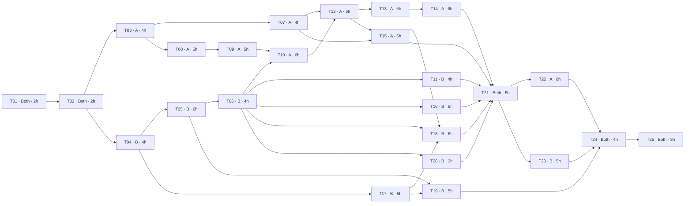

# Critical path, 25-task WBS and safe parallelism

**Do not confuse CPM estimates with the deadline.** The original task DAG's unrestricted, precedence-only longest-path calculation is **58 focused-hours**, with four tied critical paths; this is a *lower bound* before imposing the reality of two developers, waiting on models, flaky links and cluster debugging. Treat task durations as estimates, not completed effort or a promise. The calendar and gate evidence override estimates.

**Reading order:** precedence table → task details/WBS → zero-float branches → parallel windows → when blocked, pick an independent task. A task whose predecessor merely has code committed but has not passed its integration gate remains blocked.

---

<!-- This file consolidates related plans. Any unchecked boxes, MEASURE placeholders or example values require actual implementation and evidence. -->

## Critical path and parallel dependency analysis

**Method:** CPM on the concrete WBS task dependency DAG in `CRITICAL-PATH.md`, using estimated focused-engineer hours (unlimited resources). Calculated precedence-only project length: **58 hours**. **Important:** since `Both` tasks consume two people and developer B has sequential resource limits, this is a theoretical *lower bound*, **not a credible elapsed-time forecast**. The daily capacity calendar in `TWO-DEVELOPER-PLAN.md` controls actual work. Recompute after estimates change.

### Finish-to-start precedence table (hours)
| ID | Owner | Dur. | Depends on | Earliest start | Earliest finish | Total float | Critical? |
|---|---|---:|---|---:|---:|---:|---|
| T01 | Both | 2 | — | 0 | 2 | 0 | **YES** |
| T02 | Both | 2 | T01 | 2 | 4 | 0 | **YES** |
| T03 | A | 4 | T02 | 4 | 8 | 0 | **YES** |
| T04 | B | 4 | T02 | 4 | 8 | 0 | **YES** |
| T05 | B | 6 | T04 | 8 | 14 | 0 | **YES** |
| T06 | B | 4 | T05 | 14 | 18 | 0 | **YES** |
| T07 | A | 4 | T03 | 8 | 12 | 12 | no |
| T08 | A | 5 | T03 | 8 | 13 | 0 | **YES** |
| T09 | A | 5 | T08 | 13 | 18 | 0 | **YES** |
| T10 | A | 6 | T09, T06 | 18 | 24 | 0 | **YES** |
| T11 | B | 4 | T06 | 18 | 22 | 18 | no |
| T12 | A | 5 | T10, T07 | 24 | 29 | 0 | **YES** |
| T13 | A | 5 | T12 | 29 | 34 | 0 | **YES** |
| T14 | A | 6 | T13 | 34 | 40 | 0 | **YES** |
| T15 | A | 5 | T07, T12 | 29 | 34 | 0 | **YES** |
| T16 | B | 5 | T06 | 18 | 23 | 17 | no |
| T17 | B | 5 | T04 | 8 | 13 | 21 | no |
| T18 | B | 6 | T15, T17, T06 | 34 | 40 | 0 | **YES** |
| T19 | B | 5 | T17, T05 | 14 | 19 | 32 | no |
| T20 | B | 3 | T06 | 18 | 21 | 19 | no |
| T21 | Both | 5 | T14, T15, T16, T11, T18, T20 | 40 | 45 | 0 | **YES** |
| T22 | A | 6 | T21 | 45 | 51 | 0 | **YES** |
| T23 | B | 5 | T21 | 45 | 50 | 1 | no |
| T24 | Both | 4 | T22, T23, T19 | 51 | 55 | 0 | **YES** |
| T25 | Both | 3 | T24 | 55 | 58 | 0 | **YES** |

### Zero-float branches (not a single linear path)
There are **four tied longest paths** (58 estimated focused-hour units under unrestricted CPM); the zero-float tasks form a *fork-and-join subgraph*, not a serial list:

- `T01 → T02 → T03 → T08 → T09 → T10 → T12 → T13 → T14 → T21 → T22 → T24 → T25`
- `T01 → T02 → T04 → T05 → T06 → T10 → T12 → T13 → T14 → T21 → T22 → T24 → T25`
- `T01 → T02 → T03 → T08 → T09 → T10 → T12 → T15 → T18 → T21 → T22 → T24 → T25`
- `T01 → T02 → T04 → T05 → T06 → T10 → T12 → T15 → T18 → T21 → T22 → T24 → T25`
 The main risk is that indexer + real retriever + eval become inputs to CI end-to-end, then both tracks are blocked at integration. A one-hour delay to a zero-float task propagates to the theoretical finish unless recovered by scope/resource adjustment.

### Dependency graph

### Safe parallel work windows
1. After T02: **A T03 corpus verification / T07 labels** while **B T04–T06 Docker/Kubernetes stub path**. Neither must edit the other's files.
2. After A T08 starts: **A extraction/clean/chunk** while **B T11 probes, T16 policies, T17 CI static tests and T20 UI** after G2. B may test against `--dummy` without waiting for true embeddings.
3. After first real Chroma collection (T10): **A T12–T15 retrieval/generation/eval** while **B T17/T19 CI/CD and security proof**. CI e2e T18 is blocked by A's evaluator and the functioning stub/index setup.
4. At T21 **both join for integration**; do not run another large feature branch in parallel. After T21: **A T22 tuning/faults** while **B T23 rollout/HPA/security evidence**; merge at T24.

### Explicit blocked-by rules
- T10 cannot be validated against real Chroma until **both** chunker T09 and K8s Chroma T06 exist. A may write unit tests meanwhile.
- T12 needs T10 (real vectors) **and** golden labels T07 to test version/exact-term behavior.
- T13/T14 cannot claim grounded behavior until T12 retrieval's Passage contract is verified.
- T18 e2e cannot claim evaluation until T15's metric+gate functions are implemented and the fixture indexer actually indexes fixtures rather than just dummy passages.
- T21 requires both streams green; T24 requires T22/T23 proof and T19 CD. A passing stub smoke **does not** satisfy the real-RAG gate.

### Recovery playbook if late
Prioritize correct 3-replica cluster, real single-writer indexer, verified citations and abstention, measured eval gate and CI before bonuses. Drop hybrid lexical retrieval, additional UI redesign, in-cluster Ollama and extra observability dashboards if P0 is at risk. Do not fake golden results, loosen CI thresholds silently or use :latest to save time.

---

## Work breakdown structure (WBS) — runnable handoffs

Each task is a separate issue or small PR. `deps` are **finish-to-start gates**, not merely suggestions. A/B should develop independent non-overlapping code in parallel after `T02`. Durations are **planning estimates of focused engineering hours**, not observed times or promises.

| ID | Task | Owner | Effort h | Hard dependencies | Phase | Key files |
|---|---|---|---:|---|---|---|
| T01 | Unpack starter, run baseline, initialize repo and dev branch | Both | 2 | — | 00 | `README.md; AGENTS.md` |
| T02 | Freeze public contracts, roles, ADR conventions | Both | 2 | T01 | 00 | `INTERFACE-CONTRACTS.md; TWO-DEVELOPER-PLAN.md` |
| T03 | Verify corpus URLs, versions, scans, manifest | A | 4 | T02 | 01 | `corpus/sources.yaml; corpus/MANIFEST.md; CORPUS-PLAN.md` |
| T04 | Build minimal API/UI/indexer Dockerfiles | B | 4 | T02 | 01 | `api/Dockerfile; indexer/Dockerfile; ui/Dockerfile` |
| T05 | K8s namespace, services, config, Chroma/Redis PVCs, Jobs | B | 6 | T04 | 02 | `k8s/base/*; overlays/dev/*` |
| T06 | Boot minikube + dummy index + stub ingress | B | 4 | T05 | 02 | `k8s/overlays/dev/*; docs/evidence/*` |
| T07 | Create true 15-question golden set before tuning | A | 4 | T03 | 01 | `eval/golden.yaml; CORPUS-PLAN.md` |
| T08 | Implement extraction incl OCR and table samples | A | 5 | T03 | 03 | `indexer/pipeline/extract.py; indexer/tests/*` |
| T09 | Implement cleaning, structure-aware chunking | A | 5 | T08 | 03 | `indexer/pipeline/clean.py; chunk.py` |
| T10 | Implement pinned batched embedding and safe Chroma store | A | 6 | T09, T06 | 04 | `indexer/pipeline/embed.py; store.py; run.py` |
| T11 | Implement API readiness and embedding pin | B | 4 | T06 | 03 | `api/app/routes/health.py; main.py; k8s/base/*` |
| T12 | Implement Chroma retrieval, version filtering, floor | A | 5 | T10, T07 | 04 | `api/app/retrieval/chroma.py; api/app/config.py` |
| T13 | Implement selected real LLM provider and safe prompt | A | 5 | T12 | 05 | `api/app/providers/llm/ollama.py; services/*` |
| T14 | Implement orchestration, citation guard and Redis cache | A | 6 | T13 | 05 | `api/app/services/answer.py; services/cache.py` |
| T15 | Implement eval functions, by-type metrics, gate | A | 5 | T07, T12 | 05 | `eval/run_eval.py; eval/tests/*` |
| T16 | Implement deny-default NetworkPolicy, service accounts, HPA | B | 5 | T06 | 04 | `k8s/base/*` |
| T17 | CI lint/test/build/kubeconform/Trivy skeleton | B | 5 | T04 | 04 | `.github/workflows/ci.yml` |
| T18 | CI fixture e2e cluster index + evaluation gate | B | 6 | T15, T17, T06 | 06 | `.github/workflows/ci.yml; k8s/overlays/*` |
| T19 | CD SHA-tag image build/push + ephemeral deploy | B | 5 | T17, T05 | 06 | `.github/workflows/cd.yml` |
| T20 | UI through ingress, read-only nginx, route verification | B | 3 | T06 | 03 | `ui/Dockerfile; ui/nginx.conf; k8s/base/ingress*` |
| T21 | Pair end-to-end integration and defect resolution | Both | 5 | T14, T15, T16, T11, T18, T20 | 07 | `api/*; indexer/*; k8s/*` |
| T22 | Measure chunk configs/cache threshold; 4 failure experiments | A | 6 | T21 | 07 | `PIPELINE-IMPLEMENTATION.md; FAILURE-ANALYSIS.md` |
| T23 | Pod deletion, rollback, HPA, resource and security evidence | B | 5 | T21 | 07 | `docs/evidence/*; ENGINEERING-NOTES.md` |
| T24 | Final joint regression; resolve checker failures | Both | 4 | T22, T23, T19 | 08 | `tests; docs; scripts/check_submission.py` |
| T25 | Freeze README, 7 notes, AI usage, submission URLs | Both | 3 | T24 | 08 | `README.md; docs/*; eval/results.json` |

### File ownership and handoff rule
A owns `indexer`, `api/app/retrieval`, `api/app/providers`, `api/app/services`, `eval`, `corpus`. B owns `k8s`, workflows, `ui`, Dockerfiles and API health/metrics. Shared `schemas.py`, `config.py` and `main.py` require an explicit short contract PR or pairing. For each task: write tests; run commands; provide the exact output and commit SHA; link the consumer task in PR; request review before changing another owner's path.

### What counts as complete per task
A task is **not DONE** if it only compiled or generated files. It must satisfy `DEVELOPMENT-FLOW.md` and its phase gate; its PR must record **actual** test outputs, generated artifact/evidence path, and the next task unblocked. Add uncertainty/blockers rather than invent evidence.

### Assignment coverage
Every `Rxx` in `PRD.md` must connect to a WBS task and a passing proof. Extra bonus features must not postpone P0 tasks.

---

