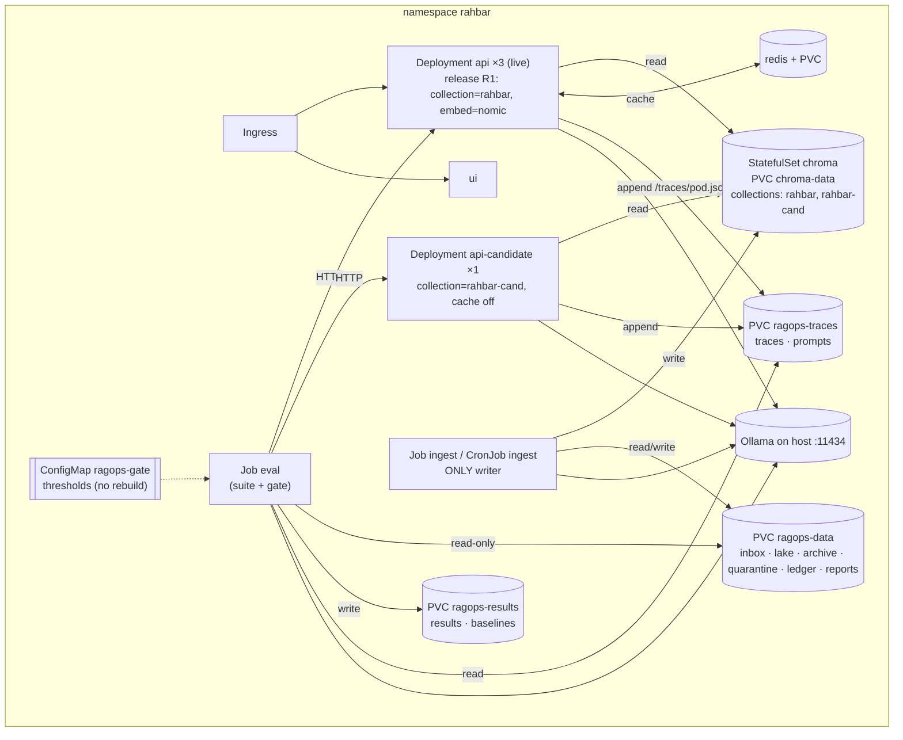
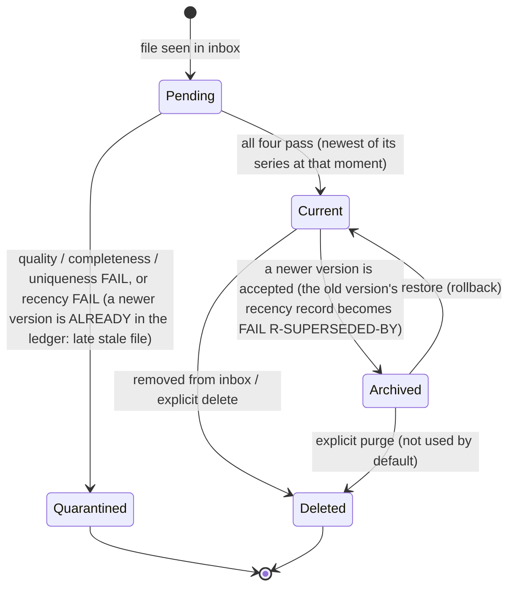

# 04 — Target architecture and design decisions

How the RAGOps layer sits on top of RAHBAR. Everything here is a **design**; each box is a task in [11](11-IMPLEMENTATION-PLAN.md). Exact formats are in [14](14-INTERFACE-CONTRACTS.md).

---

## 1. The picture (Kubernetes view)



Three kinds of long-lived storage are separated on purpose:

| PVC | Holds | Written by | Read by | Survives |
|---|---|---|---|---|
| `chroma-data` (A2, StatefulSet template) | vectors + chunk text + metadata | **ingest Job only** | api, api-candidate | pod restarts |
| `ragops-data` (new) | **the data lake**: inbox, verified documents, archive, quarantine, ledger, verification reports, chunk snapshots | ingest Job (+ loader pod for dropping files) | eval Job (read-only), report scripts | pod restarts |
| `ragops-traces` (new) | trace JSONL (one file per API pod) and the prompt store | api, api-candidate | trace tool, summary, eval | pod restarts |
| `ragops-results` (new) | timestamped result files, baselines, gate decisions | eval Job | you (`kubectl cp`) | pod restarts |

---

## 2. Figure 3, stage by stage — what we build, where, what is deliberately missing

This table is the **draft of report table 1** (G1). The "missing" column must stay honest; fill `MEASURE`/status at the end.

| Figure-3 stage | What our pipeline does | File(s) | What is missing / limits |
|---|---|---|---|
| **1 Ingest** | Pulls documents from a drop-zone (`inbox/`) on the data PVC on a schedule (CronJob) or on demand (Job); detects adds, changes and removals by comparing the inbox with the ledger; extracts text (PDF text, tables, OCR, HTML, MD, TXT) | `indexer/pipeline/catalog.py`, `extract.py`, `run.py` | polling only (no webhook/CDC/file-watcher); text formats only; no live external APIs |
| **2 Verify** | Four checks per document (quality, completeness, recency, uniqueness) with a reason each; failures quarantined; one report per run | `indexer/pipeline/verify.py`, `report.py` | **consistency** (contradiction) check not built; no malicious-content detection at ingest (paper §8 admits this gap too) |
| **3 Update data lake** | Verified documents stored once per version on the PVC; stale versions **archived**, never deleted; ledger records every change; restore and delete operations | `lake.py`, `ledger.py`, `ops.py` | no access-control metadata; single lake for one RAG system |
| **4 Update retrieval sources** | Incremental: unchanged = 0 embeds; changed = replace that document's chunks; deleted = chunks removed (orphan count 0); superseded = metadata flag; registry revision bump invalidates the API cache | `incremental.py`, `store.py` | embedding/chunking change = full rebuild of a *new* collection (not incremental by design) |
| **5 Offline testing** | Golden set + three-level suite (module, component, end-to-end), seeds, run twice, one command, timestamped result; gate script with config thresholds | `ragops/suite/**`, `ragops/gate/**`, `eval/golden.jsonl` | no public benchmarks (BEIR/MS MARCO); small golden set; judge is a 3B model |
| **6 Live testing** | Shadow-style: candidate Deployment evaluated in parallel with live; staged rolling release; continuous traces + metrics + trace summary over a time window | `k8s/ragops/candidate.yaml`, `scripts/ragops/release.sh`, `ragops/trace/**` | no A/B split of real users; no automatic alerting (thresholds are reported, not paged) |
| **7 Check coverage** | Query coverage: embedding similarity of live queries to the nearest golden question; share above a justified threshold; uncovered queries grouped; non-zero exit below threshold | `ragops/coverage/coverage.py` | retrieval/generation coverage not built; topic grouping is simple (keyword + embedding clustering), not UMAP |
| *a–g DevOps loop* | A2 CI/CD + Kubernetes; Part F adds Jobs, candidate Deployment, rollout/undo | `.github/workflows`, `k8s/**` | full suite is local-cluster only (Ollama on the host) |

---

## 3. Data flow for one ingestion run

```mermaid
sequenceDiagram
  participant Op as Operator / CronJob
  participant J as Job ingest
  participant L as PVC ragops-data
  participant E as extract/clean
  participant V as verify
  participant C as Chroma (live collection)
  participant O as Ollama (embed)
  Op->>J: kubectl apply -f k8s/ingest-job.yaml
  J->>L: acquire lock, load ledger
  J->>L: list inbox (desired state)
  J->>E: extract changed/new files (hash differs from ledger)
  E-->>J: Document(pages, resolved metadata)
  J->>V: quality, completeness, recency, uniqueness
  V->>O: embed doc sample (near-duplicate check)
  V-->>J: pass/fail + reason per check
  J->>L: move FAIL docs to quarantine/ (+ reason file); write verification report
  J->>L: store PASS docs in lake/ (new version); archive stale versions
  J->>C: delete chunks (changed/removed docs) ; flag superseded
  J->>O: embed ONLY new chunks
  J->>C: upsert new chunks ; bump registry revision
  J->>L: write ledger + run summary (counts) ; release lock
  J-->>Op: exit 0 + JSON summary on stdout
```

Order matters and is part of the design: **verification precedes chunking** (A1-01), the ledger is written **last** (a crash leaves the ledger behind the vector store; the next run self-heals — see [05](05-DATA-MANAGEMENT.md) §9), and the registry revision is bumped **after** the vector writes (the API never sees a half-applied revision as "new").

---

## 4. The data lake and the ledger

### 4.1 Directory layout on `ragops-data` (mounted at `/data`)

```
/data
├── inbox/                       desired corpus: drop files here (+ optional _batch.yaml catalog)
├── lake/
│   └── docs/<doc_id>/<version>/ the verified original + extracted.json + chunks.jsonl + meta.json
├── archive/
│   └── <doc_id>/<version>/      same shape: superseded or deleted versions (kept for rollback)
├── quarantine/
│   └── <run_id>/<filename>      the failing file + <filename>.reason.json
├── ledger/
│   ├── ledger.json              the catalogue of everything (schema: 14 §2)
│   ├── ledger.json.bak          previous good copy (atomic-write safety)
│   └── ingest.lock              single-writer lock (holder pod, run id, started_at)
└── reports/
    ├── verification/<run_id>.json (+ .md)
    └── ingest/<run_id>.json     the counters of the run (embedded / reused / deleted / …)
```

Rules: files in `lake/` and `archive/` are **immutable once written** (a changed document is a *new version directory*). `quarantine/` is append-only. Everything is addressed by `doc_id` + `version`, never by filename alone.

### 4.2 Why a ledger (and not "just ask Chroma")
Chroma knows chunks; it does not know *documents*, *versions*, *why a file was rejected*, or *what the inbox looked like last time*. The ledger holds exactly that and is the single source for the incremental decision. It is a small JSON document (tens of documents) written atomically (write temp, `fsync`, rename) — a database would add a moving part for no gain here.

### 4.3 Identity model (decision D-04)

| Concept | Definition | Example |
|---|---|---|
| `doc_id` | the **logical document / series** a file belongs to; stable across versions | `academic-rules` |
| `doc_version` | the human version/date label | `2026-06`, `2023-08`, `v2` |
| `content_sha` | SHA-256 of the file's bytes | `4cfee3e1…` |
| `revision` | ledger-assigned counter per `doc_id`, +1 on every accepted new content | `3` |
| `chunk_id` | `chunk_id(source, doc_version, ordinal, text)` from A2 extended with `doc_id`: `<doc_id>@<doc_version>#<ordinal>-<sha8>` | `academic-rules@2026-06#0012-9f3a1c20` |
| `status` | `current` · `archived` · `deleted` (ledger) ; chunk metadata `status` + `superseded` bool | `archived` ⇒ `superseded=true` |

Because the chunk id carries the digest of its text, an unchanged document regenerates identical ids and hashes → **no embedding is needed to know it is unchanged** (the document-level `content_sha` short-circuits even earlier).

### 4.4 Ledger as a state machine (per document version)



`Quarantined` documents are **not** in the ledger's live set (they are recorded for audit and never indexed). `Deleted` keeps a tombstone and the archived bytes so a delete can be reversed (A2-05 spirit, paper 4.2.3).

---

## 5. Retrieval-side changes (small, additive)

1. **Chunk metadata** gains `doc_id`, `status`, `content_sha`, `ingest_run`, `revision` (the five A2 keys stay).
2. **Registry** (`<base>-registry` collection metadata) keeps `active` (the collection name, now constant for in-place updates), `generation` (**data revision counter**, e.g. `r0007`), `embed_model`, `dimension`; the retriever's `generation` property reads it from there (today it reads the collection's own metadata, which an in-place update cannot change).
3. **`POST /api/retrieve`**: same retrieval path as `/api/ask` (embed → filter → exact-term/table assists → top-k) but **no generation**, returns the ranked passages with scores, doc ids and versions. Enabled by `EVAL_ENDPOINTS_ENABLED`.
4. **Eval headers** (`X-Eval-Bypass-Cache`, `X-Eval-Seed`, `X-Eval-Temperature`, `X-Eval-Run`), honoured only when `EVAL_HEADERS_ENABLED=true`.
5. **Trace writer** and **rail logger** wrap the existing stages in `answer_question` (see [08](08-OBSERVABILITY-TRACING.md)). Behaviour of the answer path is unchanged.

---

## 6. Release identity and rollback mechanics (decision D-11)

```
Deployment api (live)                         Deployment api-candidate
  template.env:                                 template.env:
    RELEASE_ID=R1-nomic                           RELEASE_ID=R2-mxbai
    CHROMA_COLLECTION=rahbar                      CHROMA_COLLECTION=rahbar-cand
    EMBED_MODEL=nomic-embed-text                  EMBED_MODEL=mxbai-embed-large
    EMBED_VERSION=<ollama digest>                 EMBED_VERSION=<digest>
    TOP_K=5, PROMPT_VERSION=…                     REDIS_URL=""   (cache off)
  envFrom: rahbar-config (everything else)      envFrom: rahbar-config
```

A **release** copies the candidate's `env` block onto the live Deployment (`kubectl set env` or a patched manifest), producing a new ReplicaSet; `kubectl rollout status` watches it (`maxSurge 1`, `maxUnavailable 0` ⇒ live never drops below 3 ready pods); `kubectl rollout undo deployment/api` restores the previous ReplicaSet **and with it the previous env values**, so the next trace shows `collection=rahbar`, `embedding=nomic-embed-text@<digest>` again. Full procedure: [07](07-CHANGE-AND-RELEASE.md) §8 and [10](10-KUBERNETES.md) §6.

Why this holds: the pin check keeps a mismatched pod unready, so a *bad* release (wrong collection, empty collection, wrong embed model) simply never becomes Ready and the rolling update stalls with the old pods still serving — then `rollout undo` makes the Deployment match reality again.

---

## 7. Trust and network graph (additions to A2)

| From → To | Allowed | Why |
|---|---|---|
| ingest → chroma:8000 | yes (A2) | writer |
| ingest → Ollama host:11434 | yes (A2) | embeddings |
| ingest → web 80/443 | **only** while seeding the inbox from `fetch.py` (A2 rule kept; disable once seeded) | corpus fetch |
| api, api-candidate → chroma:8000 | yes | readers |
| api → redis:6379 | yes (A2) | cache |
| api-candidate → redis | **no** | cache off (C-08) |
| eval → api:8000, api-candidate:8000 | yes (new) | suite |
| eval → Ollama host:11434 | yes (new) | module tests + judge |
| eval → chroma | **no** | all retrieval goes through the API endpoint |
| eval → redis | no | cache bypassed |
| loader pod → anything | no (DNS only) | only copies files into the PVC |
| ui → chroma | **no** (A2) | unchanged |

---

## 8. Component map (new modules)

```
indexer/pipeline/
  catalog.py      resolve metadata (catalog > embedded > derived); discover inbox
  verify.py       four checks → VerificationResult
  lake.py         inbox/lake/archive/quarantine moves; atomic file ops
  ledger.py       ledger load/save/lock; state transitions; digest
  incremental.py  reconcile(ledger, inbox) → plan; execute plan against Chroma
  report.py       verification + ingest reports (json + md)
  ops.py          restore · delete · count · rebuild-candidate CLI
  run.py          (modified) sync command orchestrates the above
  store.py        (modified) upsert/delete helpers; registry revision; keep rebuild path
api/app/
  services/trace.py     TraceRecorder, StageTimer, prompt store, writers
  services/rails.py     retrieval rail (scan/neutralise/flag) returning actions
  routes/retrieve.py    retrieval-only endpoint
  routes/metrics.py     (modified) + top-1 similarity, per-stage latency, injection flags
ragops/
  suite/   golden.py metrics.py module_level.py component_level.py e2e_level.py judge.py
           stochasticity.py summary.py run_suite.py
  gate/    apply.py
  trace/   show.py summary.py
  coverage/coverage.py
  config/  gate.yaml coverage.yaml suite.yaml
eval/  golden.jsonl pairs.jsonl live_queries.jsonl judge_labels.jsonl results/
traces/ (committed samples)
corpus/batch-b/ (planted-problem documents, ours, committed)
k8s/ eval-job.yaml ingest-job.yaml ragops/*.yaml README.md
```

---

## 9. Quality-attribute view (preview of report table 2; full drafts in [08](08-OBSERVABILITY-TRACING.md) §12)

| Quality | Mechanism in this design |
|---|---|
| Adaptability | incremental updates; candidate collection built from the lake; release identity in the pod template; chunk/embedding as config |
| Monitorability | gate thresholds; metrics endpoint; trace summary over a window; data-source change detection by ledger digest |
| Observability | trace of every stage; injection-flag counts; context-adherence (faithfulness) in the suite |
| Traceability | versions in every chunk id; trace links query → chunks → doc versions → collection → embedding; prompt store + hash re-verification |
| Reliability | `maxUnavailable: 0`, probes, HPA, PVC persistence, single-writer lock, resource limits from measurements |

---

## 10. Decision log (D-01 … D-15)

Each decision is final unless a task reveals a blocker; if so, change the decision here **first**, then the dependent files. Alternatives are listed so the viva answer is ready.

| ID | Decision | Rationale | Alternative rejected |
|---|---|---|---|
| **D-01** | Extend the RAHBAR repo and the `rahbar` namespace. | PDF: "build on your RAHBAR pipeline". Minimal new moving parts. | A second repo/namespace: duplicates the cluster work. |
| **D-02** | The data lake is a directory tree on PVC `ragops-data` with a JSON ledger. | Needs only a filesystem; survives pod restarts (F1-04); human-inspectable for screenshots. | S3/MinIO: extra service; SQLite: opaque in screenshots. |
| **D-03** | Update the live Chroma collection **in place**, driven by the ledger; keep the registry, with `generation` = data revision counter. Full rebuild only for candidate collections. | A2-01 (zero re-embeds) is impossible with rebuild-every-run. | Rebuild a new generation but copy vectors from the old one: still writes everything, and complicates rollback. |
| **D-04** | `doc_id` (series) + `doc_version` + `content_sha` + ledger `revision`; chunk id = `<doc_id>@<version>#<ordinal>-<sha8>`. | A2 already hashes chunk text; adding `doc_id` makes delete-by-document exact. | Filename identity: breaks on renamed duplicates and versions. |
| **D-05** | Both PDF statements applied literally to two events: a **newer version arriving** passes recency and the **older indexed version is archived** (recency re-evaluated as FAIL `R-SUPERSEDED-BY`, outcome archive, restorable); a **late stale file** (older than a version already in the ledger) **fails recency and is quarantined**. Same-run versions are processed oldest-first. Quality/completeness/uniqueness failure ⇒ quarantine. | Satisfies A1 ("fail ⇒ quarantine") and A2 ("superseded ⇒ archived, restorable") together; keeps A2's version questions working. 01 §9 Q1 (final). | Archiving every stale file (my first design) contradicts A1; quarantining the superseded version contradicts A2. |
| **D-06** | Metadata resolution order: catalog > embedded > derived; page count always computed. | The demo batch is unseen; completeness must be a real check. | Require a catalog: fails the demo. |
| **D-07** | Add `POST /api/retrieve` (no generation) and eval request headers behind env flags. | Makes the suite tractable on CPU; enables seeds and cache bypass. | Hit `/api/ask` for everything: hours per run. Query Chroma directly from the eval Job: bypasses the filter/assist logic being tested. |
| **D-08** | `eval/golden.jsonl`; relevance judged at `(doc, page)`; hard questions carry ground truth; `requires_batch` for Batch-B questions. | PDF requires document + page; allows E3 drift runs. | `(source, section)`: PDF says page. |
| **D-09** | The one change under test is the **embedding model** (baseline `nomic-embed-text`). Candidates: `bad` (deliberately weak, expected to fail the gate) and `good` (expected to pass). Final choice recorded in [07](07-CHANGE-AND-RELEASE.md) §2 after a 30-minute feasibility check. | It exercises all three levels (module changes only with an embedding change), makes F3-05 meaningful (the trace shows a different embedding *and* collection), and matches the paper's Table 1 example. | Chunk size (module level barely moves), top-k or prompt (collection and embedding identical, so F3-05 shows nothing). |
| **D-10** | Trace = one JSON line per query on stdout **and** appended to `/traces/<pod>.jsonl`; prompt text in a content-addressed store; hash in the line. | Meets F4 and D2 with proof (re-hash). | Full prompt in every line: bloats stdout, doubles log volume. |
| **D-11** | Release-scoped settings are explicit `env` in the Deployment template; the candidate Deployment is a separate object with a distinct label, Service and collection, cache off. | Makes `rollout undo` restore *everything* (C-07); prevents cache thrash (C-08). | Editing the shared ConfigMap: undo would not revert it. |
| **D-12** | Live testing = shadow-style candidate (same eval traffic, no user impact) + staged rolling update. | Paper 4.2.6 offers shadow/A-B/staged; cheap and demonstrable. | A/B with a traffic split: needs an ingress/mesh change not asked for. |
| **D-13** | Gate thresholds in `gate.yaml`, mirrored by ConfigMap `ragops-gate`; baseline result file stored on `ragops-results`; baseline changes only by an explicit promote step. | F2-05 requires change-without-rebuild; prevents CI-side auto-update of the baseline. | Thresholds in code (A2): needs a rebuild. |
| **D-14** | One new image `rahbar-ragops` (suite, gate, coverage, trace tools) used by the eval Job and by the tools on the laptop; ingestion stays in the `indexer` image. | Keeps the A2 images' roles intact. | Bake the suite into the indexer image: couples release cadences. |
| **D-15** | "Only one writer" is enforced by four layers: code boundary tests; ingest lock + `concurrencyPolicy: Forbid` + `parallelism: 1`; NetworkPolicy limiting Chroma clients to api/candidate/ingest; ServiceAccounts without API tokens. State plainly that Chroma has no auth. | Honest and viva-proof. | Claiming K8s makes Chroma read-only: false. |
