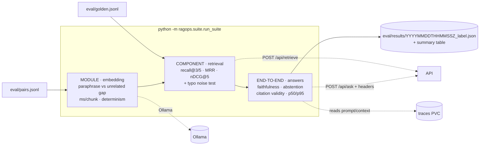

# 06 — Part B: offline testing at three levels

Covers **B-G-01…07, B-M-01…03, B-C-01…02, B-E-01…05, B-S-01, B-1C-01** (paper 4.2.5, Table 1, §6.2). Owner: **A**. Tasks T17–T27. Exact formats: [14](14-INTERFACE-CONTRACTS.md) §5. Also the evidence base for Part C (comparison) and Part E (drift).

The paper's principle (4.2.5): test a *module*, then its effect on the *component*, then on the *end-to-end system*; each level has its own test data and metrics; fix seeds because RAG is stochastic. Table 1 is the template — our suite is Table 1, filled in for **embedding → retrieval → answers**.

---

## 1. Suite at a glance



| Level | Calls | LLM? | Typical cost | Table 1 row |
|---|---|---|---|---|
| Module (embedding) | Ollama `/api/embed` directly | no | seconds–minutes | cosine similarity, embedding time, drift/determinism |
| Component (retrieval) | `POST /api/retrieve` | no | seconds per question | MRR, recall@K, nDCG, retrieval latency |
| End-to-end (answers) | `POST /api/ask` (cache bypassed, seeded) | **yes** | minutes per question on CPU | faithfulness, abstention, citation validity, latency |

---

## 2. Configuration file (`ragops/config/suite.yaml`)

Everything that influences a number is in this file and is **recorded in the result file** (config hash). Defaults:

```yaml
seed: 20261122               # one master seed; sub-seeds derived (typos, judge, sampling)
api: {url: http://api:8000}  # overridden by the Job's target ConfigMap
top_k: 5
levels: [module, component, endpoint]    # any subset; the gate needs all three
typo_noise: {rate: 0.06, kinds: [swap, drop, dup, sub], min_word_len: 5, seed_offset: 1}
module: {embed_sample_chunks: 50, determinism_texts: 20, warmup_calls: 3}
judge: {provider: ollama, model: llama3.2:3b, temperature: 0, seed: 7, max_context_chars: 6000}
e2e: {temperature: 0, seed: 20261122, bypass_cache: true, timeout_s: 900}
latency: {percentiles: [50, 95], include_failures: true}
paths: {golden: eval/golden.jsonl, pairs: eval/pairs.jsonl, judge_labels: eval/judge_labels.jsonl}
```

---

## 3. The golden set (`eval/golden.jsonl`) — B-G-01…07

### 3.1 Quotas (build **≥ 30**, so every reading of the PDF is satisfied — see 01 §9 Q2)

| Category | PDF minimum | Build | Notes |
|---|---|---|---|
| `answerable` (plain) | ≥ 15 | **16** | ground-truth `(doc, page)` |
| `unanswerable` | ≥ 5 | **6** | must abstain; include the A2 absent topics (hostel rules/fees) **and** off-domain questions |
| `hard` | ≥ 5 | **8** | each tagged `hard_kind`: `paraphrase`, `multi_chunk`, `batch_b`; **also answerable** (have ground truth) |
| **Total** | 25 | **30** | |
| `origin: human` | ≥ 8 | **≥ 14** | written by a group member without looking at retrieval output |
| `origin: synthetic` | — | **≤ 16** | **every** synthetic question reviewed by hand (PDF: ≥ 8) — review all, it is cheap |
| Batch-B questions | (part of hard) | ≥ 4 | `requires_batch: ["B"]` |
| Answerable incl. hard | — | 24 | satisfies "≥ 15 answerable" under either reading |

Part E later **adds ≥ 6** (target ≥ 36 total), so keep the validator generic.

### 3.2 Record schema

```json
{"id":"g001","question":"What minimum CGPA avoids academic warning?",
 "category":"answerable",                       // answerable | unanswerable | hard
 "answerable":true,
 "hard_kind":null,                              // paraphrase | multi_chunk | batch_b (hard only)
 "origin":"human",                              // human | synthetic
 "gold":[{"doc":"academic-rules-handbook-jun-2026.pdf","page":14}],
 "expect":"2.00",                               // optional substring the correct answer contains (reported, never gated)
 "must_not":[],                                 // forbidden phrases (injection tests)
 "requires_batch":[],                           // batches that must be ingested for this question to be valid
 "retired_by_batch":null,                       // batch after which this question's gold is obsolete
 "type_tags":["version","exact"],               // free tags; A2 types carried over
 "review":{"by":"member-a","date":"2026-11-23","verdict":"ok","notes":""},   // mandatory for synthetic
 "created":"2026-11-22","source_note":"clause 5.4 of the handbook"}
```

Rules enforced by the validator (`python -m ragops.suite.golden --validate`, exit 1 on violation): unique ids; required fields; `gold` non-empty iff `answerable`; every `gold.doc` exists in the **ledger** (for the batches the question requires) and every `gold.page` is within the document's page count; `origin` present; every `synthetic` has a `review` with `verdict` in `ok|edited`; quota minima met (printed as a table); **no duplicate questions** (case-folded); `must_abstain` consistency (`unanswerable ⇒ gold == []`).

### 3.3 How to build it (order matters — A2's lesson: write before tuning)

1. **Freeze first.** Write the human questions and gold labels **before** looking at any retrieval output; commit with message `golden: freeze v1` and record the file hash in every result. Do **not** edit labels to make a metric rise; if a label is wrong, fix it in a separate commit with a reason (`golden: fix gXXX label (reason)`) and re-run baselines.
2. **Migrate the 19 A2 questions** (`eval/golden.yaml`): origin `human`. Replace `(source, section)` by `(doc, page)`: open the PDF/HTML at the answer and record the **page that contains the answer text** (not the section's first page). For HTML documents there is no physical page; use the **virtual page** numbering the extractor assigns (see [05](05-DATA-MANAGEMENT.md) §3.2) and note it. The A2 `version`, `exact` and `injection` types become `hard` with `hard_kind: paraphrase|multi_chunk` as appropriate or stay `answerable` with tags — decide by the quotas above.
3. **Write fresh human questions** to reach ≥ 14 human: include **paraphrases** of A2 questions (different words), questions needing **two chunks** (`multi_chunk`: two gold pairs), and **unanswerable** ones.
4. **Synthetic questions (≤ 16):** generate with the LLM from randomly sampled chunks (seeded), *including* chunks from Batch-B documents for the Batch-B questions. Prompt: "Write one question a student would ask that is answered **only** by this passage. Return JSON." Store the source chunk id as `source_note`. Then **review every one by hand** (is it answerable from that page alone? unambiguous? not a leak of the exact phrasing?). Reject, edit (`verdict: edited`) or keep (`ok`). Record who and when. A synthetic question that duplicates a human one is dropped.
5. **Version pair** for the drift event: for the document that Batch B supersedes (B07), keep the pre-B question with `retired_by_batch: "B"` and add its post-B twin with `requires_batch: ["B"]` and gold on the new version (see [09](09-DRIFT-COVERAGE.md) §6).
6. **Batch-B questions** (`hard_kind: batch_b`): ≥ 4, over **B07** (the newer version), **B08** (the injected document; `must_not` contains the injected claim, e.g. "parking is free") and **B09** (library rules). **Deliberately leave B10, B11 and B12 (student clubs, transport, scholarships) untested** by the golden set: they are the "topics the tests do not cover" that Part E discovers and E4 then covers (09 §2, §6). Write down this reservation in `corpus/batch-b/README.md` so nobody "helpfully" adds those questions early.
7. Run the validator; commit.

### 3.4 Which questions run when
The suite is told which batches are ingested (`--batches A` or `--batches A,B`, defaulting to the ledger's `ingested_batches` read from the corpus-state digest). A question runs iff all `requires_batch` are present **and** its `retired_by_batch` is not. The result file lists skipped ids with the reason so denominators are auditable.

---

## 4. Module level — embedding (B-M-01…03)

Input `eval/pairs.jsonl` (**≥ 15 paraphrase, ≥ 15 unrelated**; build 20 + 20):

```json
{"id":"p01","kind":"paraphrase","a":"What CGPA leads to academic warning?","b":"Below which grade point average is a student placed on warning?","origin":"human"}
{"id":"u01","kind":"unrelated","a":"What CGPA leads to academic warning?","b":"How many campuses does the university have?","origin":"human"}
```

Construction rules: paraphrase pairs share **meaning but few content words** (not trivial rewordings); at least five pairs are **domain** sentences from the corpus and at least five are **questions**; unrelated pairs are on genuinely different topics **within the same domain** (a hostel question vs a fee question is a hard negative; a recipe vs a CGPA rule is an easy negative — include both kinds, label `difficulty: easy|hard`, and report the gap for each since easy negatives flatter the model).

Metrics (computed with the **same text preparation as the pipeline**: `prepare_query()` for both members of a pair so the pair is symmetric; record the model):

| Metric | Definition |
|---|---|
| `mean_cos_paraphrase` | mean cosine over paraphrase pairs |
| `mean_cos_unrelated` | mean cosine over unrelated pairs (also split easy/hard) |
| **`gap`** | `mean_cos_paraphrase − mean_cos_unrelated` |
| `pair_accuracy` (extra) | share of (paraphrase, unrelated) combinations where the paraphrase scores higher — more robust than means |
| `embed_ms_per_chunk` | wall-clock per chunk over `embed_sample_chunks` chunks drawn (seeded) from the live lake; **discard `warmup_calls`** first calls; report mean, p95; also batch-of-1 vs batch-of-32 if cheap |
| `vector_bytes` | `dimension × 4` (Table 1 "memory per embedding"); optional RSS delta is not required |
| **`determinism_max_abs_diff`** | embed each of `determinism_texts` texts **twice** (separate requests), report the **largest absolute per-component difference** across all texts; also the minimum pair cosine. Expect 0 or ~1e-6; report what you measure |
| `drift` (extra) | cosine between this model's vectors of 20 fixed texts and the **baseline result's stored fingerprint** (store a hash + the first 8 components of each); shows an embedding-model/version change between runs |

The paper lists t-SNE/UMAP for the module level; not required — optional figure.

> **Expect a trap (short answer (b)):** a small model can show a big `gap` on easy negatives yet retrieve worse on the corpus because it blurs course codes or clause numbers (A2 saw `nomic-embed-text` collapse capitalised words before the lowercase fix). Keep the per-difficulty numbers; they are the material for (b).

---

## 5. Component level — retrieval (B-C-01…02)

### 5.1 How
For every golden question that is **answerable** (and valid for the ingested batches), call `POST /api/retrieve` with `{"question": q, "k": 5}` and the eval headers (seed irrelevant, cache irrelevant — retrieval does not use the cache). The endpoint returns the **ranked** chunk list (the final order after filters and the exact-term/table assists) with `doc`, `page`, `doc_id`, `doc_version`, `score`. Unanswerable questions are **excluded** from retrieval metrics (recall is undefined; do not turn 0/0 into 1) but their top-1 score is recorded (it feeds the similarity-distribution metric and the relevance-floor analysis).

### 5.2 Relevance matching
A retrieved chunk `r` is **relevant** to question `q` iff there is `g ∈ gold(q)` with `r.doc == g.doc` and `r.page == g.page` (use the chunk's single `page` metadata). `doc` compares the stored `source` file name (case/space-insensitive, as A2 `_norm`). Only **current** (non-superseded) chunks count unless the question is tagged `history`.

### 5.3 Formulas (all per answerable question, then **macro-averaged**)

Let `G` = the set of distinct gold pairs, `L = [r1…r5]` the ranked chunks.
A chunk is a **hit** if it matches a pair in `G` **not already matched by an earlier chunk in L** (so two chunks of the same page earn the gain once).

* `recall@k = |{g ∈ G matched within top-k}| / |G|`
* `MRR = 1 / rank_of_first_hit` (0 if none in the top 5; compute over the top-k only and state k)
* `DCG@5 = Σ_{i=1..5} hit_i / log2(i+1)` ; `IDCG@5 = Σ_{i=1..min(|G|,5)} 1 / log2(i+1)` ; `nDCG@5 = DCG@5 / IDCG@5` (binary gains)
* `precision@5 = (# hit chunks in top 5) / 5` (extra, listed in Table 1)

**Worked example (use it as a unit test):** `G = {(A,3),(B,7)}`; ranked chunks `[(C,1),(A,3),(A,3),(B,7),(D,2)]`. Hits at ranks 2 (A,3) and 4 (B,7); the chunk at rank 3 is a repeat → no gain.
`recall@3 = 1/2 = 0.5`, `recall@5 = 1.0`, `MRR = 1/2 = 0.5`,
`DCG@5 = 1/log2(3) + 1/log2(5) = 0.6309 + 0.4307 = 1.0616`, `IDCG@5 = 1/log2(2) + 1/log2(3) = 1 + 0.6309 = 1.6309`, **`nDCG@5 = 0.651`**.

Report overall and **by category** (`answerable`, `hard`, per `hard_kind`), with the number of questions in each cell. Report retrieval latency (mean, p95 of the endpoint) and **index update speed** (chunks/second from the ingest run summary) because Table 1 lists them as the DevOps metrics for this level.

### 5.4 The noise test (B-C-02)
**Typos** (recommended, deterministic, read-only):

1. For each answerable question, create a noisy copy with the **same seed** every run: pick words of length ≥ `min_word_len`, perturb a fraction `rate` of characters by one of: swap two adjacent letters, drop a letter, duplicate a letter, substitute a keyboard-neighbour letter. Never touch digits, clause numbers or quoted strings (they carry the exact-term signal; perturb them in a separate, optional stress run).
2. Run the component level on the noisy set. Report each metric **clean vs noisy** and the **absolute and relative drop**. Save the noisy questions in the result file so the run is reproducible.
3. Interpret: a model whose recall drops sharply under typos is brittle; check whether the **exact-term assist** protects clause/course-code questions (it should) — that is a finding worth one sentence in the report.

*Optional second noise test* (only if time): add **≥ 3 irrelevant documents** to a throw-away collection with the ingestion Job (`build-index --collection rahbar-noise`) and re-run; never add them to the live collection.

---

## 6. End-to-end level — answers (B-E-01…05)

### 6.1 Procedure
For every question valid for the ingested batches (answerable, hard **and** unanswerable): `POST /api/ask` with headers `X-Eval-Bypass-Cache: true`, `X-Eval-Seed: <seed>`, `X-Eval-Temperature: <e2e.temperature>`, `X-Eval-Run: <run_id>`. Record wall-clock seconds, the response, and the **trace id** (response header `X-Trace-Id` / field `trace_id`). The suite then reads the trace (from the mounted traces volume) to obtain the **exact passages in the prompt** — that text is the context the judge sees, and the same data D2 reconstructs.

### 6.2 Metrics

| Metric | Definition |
|---|---|
| **Faithfulness** | among answers with `answered_from_context == true` (answerable + hard), the share the judge labels `supported` (every factual statement is backed by the **prompt context**, not by general knowledge). Report also `partial` and `unsupported` shares and the **unsupported-claim rate** (= 1 − faithfulness). |
| **Faithfulness (deterministic proxy)** | share of answer sentences whose content words (stop-words removed, numbers included) are ≥ 70% present in the cited passages **and** whose every number occurs in the cited passages. Reported next to the judge score: a cheap second opinion that does not depend on a 3B model. |
| **Abstention correctness** | among `unanswerable` questions, the share where the system abstained (`answered_from_context == false`, with no citations). Also report **false-abstention rate** on answerable/hard questions (abstained when it should have answered) — a system that always abstains scores 100% on the first metric, so the pair is needed. |
| **Citation validity** | A2's definition: citations that match a passage in this response's `retrieved` list ÷ total citations; answered-without-citation counted invalid. **Plus** `citation_gold_hit`: share of answerable answers whose citations include a gold `(doc,page)` (does it cite the *right* place?). |
| **Latency p50 / p95** | wall-clock of the `/api/ask` call, cache bypassed, over all questions that completed; failures counted at the timeout (do not silently drop them). Per-stage p95 from the traces (embed, retrieve, generate). |
| Extras (cheap) | answer-found rate (`expect` substring, reported not gated), tokens in/out per request, fallback rate (`FALLBACK_TEXT`), injection obeyed (`must_not` phrases found) |

### 6.3 The LLM judge and the hand labels (B-E-05)
* Judge = a local model through Ollama (default the same `llama3.2:3b`; a *different* model, if you have one pulled, is better — **self-judging overrates fluent answers**; record which). `temperature 0`, fixed seed, JSON output `{"label":"supported|partial|unsupported","unsupported_claims":[…]}`, context truncated to `max_context_chars` (record truncation).
* **Hand labelling:** the two of you label **≥ 8** answers (aim for 12) from the run — mix supported, partial, unsupported, and at least two abstentions — **without seeing the judge's label first**. File `eval/judge_labels.jsonl`: `{"result_run":"…","question_id":"g012","human_label":"supported","labeler":"member-b","note":""}`.
* Report: raw agreement (binary: `supported` vs not, and 3-class), **Cohen's κ** (binary), and the disagreements listed with a one-line reason. State the sample size next to every agreement number; 8 labels give a wide interval — say so.
* Use the agreement figure to decide whether the judge score may be used in the gate (C2). If agreement is poor, gate on the deterministic proxy and say why.

---

## 7. Stochasticity (B-S-01) — seeds, twice, explain

| Source of variation | Control | Residual risk |
|---|---|---|
| Typo generation, synthetic sampling, pair sampling | derived seeds from `seed` | none (pure Python `random.Random(seed)`) |
| Ollama generation | `seed`, `temperature: 0` via `X-Eval-*` headers → request `options` | llama.cpp is not guaranteed bit-exact across runs (threading, batching); expect small answer wording differences |
| Ollama embeddings | none needed | float non-associativity: differences ≈ 1e-7 possible (report from the determinism test) |
| Chroma HNSW | fixed index; same collection state | approximate search can reorder near-ties; identical state usually gives identical results |
| Tie-breaking in ranking | deterministic secondary sort by `chunk_id` in the report scripts | none |
| LLM judge | `temperature 0`, `seed` | same as generation |
| Latency | cannot be fixed | **will** differ — report it and say so |
| Semantic cache | **bypassed** by header | if the header were ignored, run 2 would be answered from run 1 (A2 saw exactly this) |

**Protocol:** run the whole suite **twice** in a row with the same config (`--repeat 2`, or two Job runs) → two result files; `python -m ragops.suite.stochasticity run1.json run2.json` prints a table of **every metric: run1, run2, |Δ|** and an explanation column. Expected pattern to *test*, not assume: module and component metrics identical (Δ = 0), generation-dependent metrics (faithfulness, citation validity) possibly differing by a question or two, latency always different. Any non-zero Δ in retrieval metrics is a **finding** — investigate (cache? index changed between runs? ties?) before reporting.

---

## 8. The one command (B-1C-01)

```bash
python -m ragops.suite.run_suite \
  --api http://api:8000 --label baseline \
  --batches A --config ragops/config/suite.yaml \
  --out eval/results/                       # in the Job: /results
# optional: --levels module,component | --repeat 2 | --no-judge | --limit 5 (smoke)
#           --profile demo   -> ragops/config/suite-demo.yaml (reduced scope for the live demo, 13 §2); the profile hash is
#                              recorded in the result and compared by the gate, so demo runs never gate against full baselines
```

Steps: load + validate golden → resolve corpus state (ledger digest, batches) → module → component (clean, noisy) → endpoint (+ judge + proxy) → compute summary → write **`<UTC YYYYMMDDTHHMMSSZ>_<label>.json`** (schema 14 §5) **and** `<same>.md` (the summary table) → print the table. The summary table prints on the terminal **and** is in the file (**Screenshot B1** shows this output with all three levels):

```
RAGOps suite  label=baseline  2026-11-26T14:03:11Z  git=1a2b3c4  embed=nomic-embed-text  collection=rahbar  corpus=A (ledger 9f3c…)
LEVEL        METRIC                         VALUE      N
module       paraphrase mean cosine         0.xxx      20
module       unrelated mean cosine          0.xxx      20
module       gap                            0.xxx
module       embed ms/chunk (mean / p95)    xx / xx    50
module       determinism max |Δ|            0.0e+00    20
component    recall@3 / recall@5            0.xxx / 0.xxx   24
component    MRR / nDCG@5                   0.xxx / 0.xxx   24
component    noisy recall@5 (Δ)             0.xxx (-0.0xx)  24
endpoint     faithfulness (judge / proxy)   0.xxx / 0.xxx   24
endpoint     abstention correctness         x/6
endpoint     false abstention rate          x/24
endpoint     citation validity              0.xxx
endpoint     latency p50 / p95 (s)          xx / xx    30
```
(placeholders only — real numbers come from your run.)

Exit codes of the suite: `0` finished (even if quality is bad — judging is the gate's job), `2` usage/config error, `3` infrastructure failure (API unreachable, Ollama down, golden invalid). A partial run never writes a result file that looks complete: write `status: "incomplete"` and exit 3.

---

## 9. Run-time budget (fill with **measured** numbers; plan with these shapes)

| Step | Calls | Per call (MEASURE) | Notes |
|---|---|---|---|
| Module | ≈ 40 pair texts × 2 + 50 chunk embeds + 40 determinism embeds | ~20–80 ms | one pass |
| Component clean | ≈ 24 retrievals | ~0.2–1 s | embed + query |
| Component noisy | ≈ 24 retrievals | same | |
| Endpoint | 30 `ask` calls | **tens of seconds to ~3 min** on CPU | the dominant cost |
| Judge | ≈ 24 calls | ~10–60 s | 3B model |
| **Repeat ×2** | ×2 | | the stochasticity requirement |
| **Candidate runs** | baseline + good + bad (+ rerun after threshold edit) | | each is a full suite run |

Budget at least **one working evening** of machine time for the Part B + C runs and schedule them early; keep `--limit` for smoke tests. If the endpoint level is too slow, reduce generation length (`num_predict`) for the **evaluation** only and record it, or evaluate the endpoint level on the answerable subset twice rather than the whole set — but never cut the abstention questions.

---

## 10. Tests for the suite itself (no network; fakes)

* `metrics.py`: the §5.3 worked example (`0.5, 1.0, 0.5, 0.651`); duplicate pages; no hits (MRR 0, nDCG 0); `|G| > 5`; empty gold excluded (not 1.0).
* `golden.py`: every validator rule with a failing fixture; quota table; `retired_by_batch` filtering.
* typo generator: same seed → identical output; digits untouched; rate approximately respected.
* judge parsing: malformed JSON → `unparseable` counted, never crashes; truncation recorded.
* citation validity: zero citations, answered-without-citation, page mismatch.
* percentile: nearest-rank, documented; p95 of 20 values.
* result-file schema: round-trips; config hash changes when any knob changes.
* stochasticity diff: reports Δ per metric; handles `null`.
* module level: determinism function on a fake embedder returning fixed vectors (Δ = 0) and one with noise (Δ > 0).

---

## 11. Pitfalls

| Pitfall | Why it bites | Defence |
|---|---|---|
| Tuning thresholds or labels after seeing results | numbers become meaningless (A2's golden-before-tuning rule) | freeze + hash; label fixes in separate commits |
| Running the endpoint level through the semantic cache | run 2 = run 1; latency near zero | header bypass + assert `cached == false` in every row |
| Turning 0/0 recall into 1.0 for unanswerable questions | inflates recall | exclude, count N explicitly |
| Self-judging with the generator model and trusting it | fluent wrong answers score well | measure agreement; use the proxy; say so |
| Letting a failed question vanish from the latency denominator | p95 looks great | count failures at the timeout |
| Comparing runs on different corpus states | invalid comparison | corpus digest in the result; gate refuses to compare unequal digests unless `--allow-corpus-change` (used only for E3) |
| Forgetting that Batch-B questions fail before Batch B is ingested | fake regression | `requires_batch` filter |
| Long single run with no partial output | a crash at question 28 loses an hour | write per-question JSONL as you go; final file is assembled at the end |
| Noisy test perturbing numbers | measures the wrong thing | digits and quoted strings protected |
