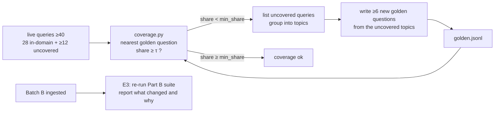

# 09 — Part E: drift and coverage checking

Covers **E1-01, E2-01…E2-03, E3-01, E4-01, E4-02** (paper 4.2.7 "Coverage checking", 4.2.5 "data distribution shifts", Figure 3 stage 7). Owner: **A**. Tasks T41–T46 in [11](11-IMPLEMENTATION-PLAN.md). Formats: [14](14-INTERFACE-CONTRACTS.md) §8.

The paper's logic (4.2.7): a test set can rot — user behaviour shifts, new domains arrive, components change — so you must **check that the offline test set still represents live usage**. If too few live queries resemble any test query, the test set is stale and must be extended. Part E makes you do that loop once, with numbers.

---

## 1. The loop (what you are demonstrating)



Order for the demo and the report: **E1 → E2 (before) → E3 → E4 → E2 (after)**. E3 uses the golden set *as it is before E4* so that its findings can motivate E4.

---

## 2. E1 — the live query log (`eval/live_queries.jsonl`)

**≥ 40** queries "as if from users": **about 28** inside the domain of the golden set, **≥ 12** from a topic your corpus or tests do not cover. Plan **44** (30 + 14) so a few can be discarded.

```json
{"id":"l001","query":"can i drop a course after 3rd week?","domain":"in","origin":"human","author":"member-a","created":"2026-11-27","note":"informal, lowercase"}
{"id":"l031","query":"when does the university bus leave from the main gate","domain":"out","origin":"human","author":"member-b","created":"2026-11-27"}
```

Rules to keep it honest (this is your own data, so it is easy to cheat):
* **Written as users write:** lowercase, abbreviations, missing punctuation, a few typos, short questions, some two-part questions. Not copies of the golden wording (a validator rejects any live query with cosine ≥ 0.98 to a golden question, and exact-string duplicates).
* **In-domain (≈ 28):** topics the corpus covers — academic rules, grading, fees, policies — including topics the golden set tests **and** topics it never tests (e.g., questions about the annual-report tables or the Student Handbook's other sections). Do not make all 28 trivially close to golden questions.
* **Uncovered (≥ 12):** two kinds, label each in `note`: (i) **corpus-covered but test-uncovered** — the new Batch-B topics reserved for Part E (**B10 student clubs, B11 transport routes, B12 scholarships**; see 06 §3.3: the golden set deliberately has no questions on them before E4); (ii) **corpus-absent** topics (e.g., placement/internship procedures if absent) that must trigger abstention. Use **at least 3 distinct topics** so that "group them into topics" is meaningful.
* Different authors write different slices; do not write all of them in one sitting from the golden list in front of you.
* Send them through the **live system** (no eval headers) once, so there is genuine "live" traffic in the traces for the summary script and for E3's before/after observations. Save the traces you commit as samples.

`origin` may be `synthetic` for some (LLM-generated paraphrases of what users ask) but then mark and hand-review them like the golden questions; the PDF does not require this for live queries, but your report should say how they were produced.

---

## 3. E2 — query coverage

### 3.1 Method
For every live query, embed it with the **live embedding model** using the pipeline's own **query preparation** (`prepare_query`, including the lowercase rule for `nomic-embed-text`); embed every golden question the same way; the **best match** is the maximum cosine over all golden questions (all categories — an `unanswerable` golden question also "covers" a similar live query, because testing abstention on that topic is real coverage). Record per live query: `best_golden_id`, `best_similarity`, `covered = best_similarity ≥ τ`.

Coverage = `|covered| / |live queries|` (also report **in-domain coverage** and **out-of-domain coverage** separately — the interesting number is usually the second).

Cross-check (cheap, from the paper): the same computation with **TF-IDF cosine** over the question text. If the two methods disagree strongly on a query, look at it: dense similarity can over-credit shared phrasing ("what is the policy on …") and TF-IDF can under-credit paraphrase. Mention it if it changes a conclusion.

### 3.2 The two parameters you must choose and justify

| Parameter | Meaning | Paper's example | How to choose |
|---|---|---|---|
| `similarity_threshold` **τ** | the score at which a live query counts as "reached" by a golden question | "a certain similarity score" (unspecified) | **Calibrate, do not guess** (below) |
| `min_share` | the share of live queries that must reach τ before coverage is "adequate" | **85%** ("if less than 85% of live queries achieve a certain similarity score … prompt a test set expansion") | start from 0.85; if you change it, say why |

**Calibrating τ (the justification the PDF asks for):**
1. Take **40 (live query → nearest golden question) pairs** (all of them, or a seeded sample if you have more).
2. **Label each pair by hand** — "would a test of the golden question tell you the system handles this live query?" (`covered` / `not covered`). Two people label independently; resolve differences.
3. Compute the similarity for each pair and choose τ at the value that best separates the labels (maximise F1, or choose the lowest τ with **no** false "covered" if you prefer a conservative gate). Show the table: τ candidates (e.g., 0.70, 0.75, 0.80, 0.85) → precision, recall of "covered".
4. State the final τ with this evidence, and the **model-specific caveat**: cosine scales differ between embedding models (07 §2.3) — if you change the embedding model the threshold must be re-calibrated, and `coverage.yaml` records the model it was calibrated for (the tool refuses a mismatch).
5. Also report the numbers at τ ± 0.05 so a reader sees how sensitive the conclusion is (this goes into short answer (d) if coverage is the metric you trust least).

### 3.3 Output and exit code (E4-02)

```
python -m ragops.coverage.coverage --golden eval/golden.jsonl --live eval/live_queries.jsonl \
       --config ragops/config/coverage.yaml [--out eval/results/] [--json]
```
`ragops/config/coverage.yaml`: `{similarity_threshold: τ, min_share: 0.85, embed_model: nomic-embed-text, calibrated_on: "eval/coverage-calibration.jsonl", seed: …}`.

Prints a table (**Screenshots E1 before / E2 after**): totals, covered, share, in/out-of-domain shares, threshold and min_share, **verdict** (`COVERAGE OK` / `COVERAGE GAP`), then the **uncovered queries** with their best match and similarity (sorted ascending). Writes a timestamped JSON + MD under `eval/results/` (`…_coverage.json`). **Exit codes:** `0` share ≥ `min_share` · **`1` share < `min_share`** (the required non-zero exit) · `2` usage/config/model mismatch · `3` embedding service unavailable. Boundary test: share exactly equal to `min_share` passes (state the rule in the code comment).

Where it runs: the `rahbar-ragops` image. On Kubernetes: `k8s/coverage-job.yaml` (optional manifest, same pattern as the eval Job, embeds through Ollama; no Chroma access) so Part E also "runs on Kubernetes"; from the laptop it needs only Ollama.

---

## 4. Grouping the uncovered queries into topics (E2-03)

1. Take the uncovered set (`covered == false`).
2. **Cluster** by embedding: agglomerative clustering with cosine-distance linkage `average`, cut at similarity ≈ 0.70 (tune so clusters are readable); seeded; no external library needed beyond NumPy (or SciPy if already in the image).
3. **Name each cluster** from its top TF-IDF terms (the paper's vocabulary-coverage idea) and then **by hand** ("student clubs", "transport", "scholarships", "placement"). A cluster of one is allowed but flagged.
4. Report as a table: **topic · number of uncovered queries · example queries · is the topic in the corpus? (yes/no, which document)**. The last column matters: *in corpus but untested* means "add golden questions"; *not in corpus* means "the correct behaviour is to abstain — add an unanswerable golden question" (both close the gap, in different ways).

(The paper also mentions t-SNE/UMAP for visualising new query clusters; optional figure.)

---

## 5. E3 — data drift: ingest Batch B, re-run Part B, explain

**Question the PDF asks:** "report what changed and why." The metrics will move; your job is to attribute each movement to a cause, not to defend the numbers.

### 5.1 Protocol
1. **Before:** the Part B baseline result on corpus state **A** (already produced; label `baseline-A`). The corpus digest is recorded in it.
2. **Event:** ingest **Batch B** with the ingestion Job (Part A procedure). Keep the verification report and the ingest summary (counts, quarantined files, archived 2022 policy).
3. **After:** re-run the **whole suite** against the live API with `--batches A,B`, same seed and config → `baseline-AB`. (The suite includes the Batch-B questions now valid and excludes the retired ones — 06 §3.4.)
4. Compare with the diff tool: `python -m ragops.suite.diff eval/results/<baseline-A>.json eval/results/<baseline-AB>.json` (`--allow-corpus-change` is required here and **only** here; the gate refuses otherwise).

### 5.2 What to look at (and the explanation categories)

| Observation | Typical cause | Classify as |
|---|---|---|
| Questions about the superseded policy fail or change gold | B07 superseded the 2022 version; `retired_by_batch` question stops being valid; its twin now validates | **expected change** (not a regression) |
| New Batch-B questions are answerable | new documents indexed | **forward adaptability** |
| Previously passing A questions lost recall@5 | new chunks displaced the gold chunk (similar wording in B09–B12), or an updated document's chunk ids changed | **regression** — inspect the displaced pair in the per-question diff |
| Top-1 similarity distribution shifted | more documents → better or worse nearest neighbours | monitor |
| Abstention changed | previously absent topics are now present (a question that *should* abstain now finds a near-match) | check the unanswerable set: a topic that Batch B now covers must be **re-labelled** answerable with a gold — not silently left as "must abstain" |
| Latency changed | larger index | usually negligible; report |
| The injected document B08 | retrieval now sometimes returns an attack chunk | rail actions appear in traces; check `must_not` |
| Exact-duplicate/near-duplicate documents | were **quarantined**, so they changed nothing | evidence that verification protected retrieval — contrast with a run where you *skip* verification (optional experiment, reversible) |

### 5.3 Two-sided reporting (the paper's "forward adaptability and backward compatibility")
Report recall@5/MRR/nDCG@5 **separately** on (a) the **common subset** (questions valid in both states): *backward compatibility* — must not drop beyond the gate; (b) the **new subset** (Batch-B questions): *forward adaptability*. A single blended number hides both stories.

### 5.4 Relabelling rule
If drift reveals that a golden label is now wrong because the world changed (not because retrieval failed), **update the golden file in a separate, explained commit** (`golden: gXXX superseded by B07`), keep the old row with `retired_by_batch`, and re-run. Never edit a label to hide a regression.

---

## 6. E4 — close the gap

1. From the E2 topic table, take the **topics in the corpus but untested** and the **corpus-absent** ones. Write **≥ 6 new golden questions** (target 8): origin `human`, or `synthetic` + reviewed; **written from the topic and the documents, not by pasting the live query** (otherwise coverage rises trivially and the metric is meaningless — say in short answer (d) that this check measures *similarity of wording*, not *similarity of difficulty*). Include at least **one new unanswerable** question for an absent topic. Mark `added_in: "E4"`.
2. Give each answerable one a `(doc, page)` gold and have the second member verify it. Run the validator.
3. Re-run **coverage** → Screenshot **E2** (after). Coverage should rise; report before/after in one table with the uncovered list shrinking. If it does **not** rise, say why (new questions too far from the live wording; τ too strict).
4. Run the **suite** on the extended golden set (`--label after-E4`) to show the **new questions are actually handled** (retrieval finds their gold; unanswerable ones abstain). A new question that the system fails is a **finding** (coverage exposed a weakness) — report it; do not delete it.
5. Re-run the gate in `--allow-corpus-change`-free mode? The corpus did not change in E4, only the golden set; the gate's `require_same: golden_hash` will rightly differ, so use the **baseline promote** step with a reason if this becomes the new baseline (07 §9).

---

## 7. Optional additions (only if time remains; each costs ≈ an hour)

* **Retrieval coverage** (paper 4.2.7 second bullet): for each live query, which `(doc,page)` it retrieves versus the set of gold `(doc,page)` pairs in the golden set; the share of live queries whose top-1 document is **outside** the golden set's documents = "retrieval drift".
* **Vocabulary coverage:** top TF-IDF terms of live queries absent from golden-question vocabulary → "new terms".
* **UMAP/t-SNE figure** of golden vs live query embeddings coloured by covered/uncovered.
* **Coverage as a gate** in the eval Job (`MODE: coverage`) next to the quality gate.

---

## 8. Tests

| Area | Cases |
|---|---|
| Similarity | identical text = 1.0; query preparation identical to the pipeline's; best-match picks the max; ties broken by golden id |
| Share | 0 live queries → exit 2; all covered → 1.0; exactly `min_share` → exit 0; one below → exit 1 |
| Validator | live query too close to a golden question rejected; missing `domain`; fewer than 40 or the 28/12 split not met (warn) |
| Clustering | deterministic with the seed; cluster of one flagged; output topics sorted |
| Model mismatch | `coverage.yaml.embed_model` ≠ live model → exit 2 |
| Calibration | the threshold chooser returns the F1-maximising τ on a toy labelled set; conservative mode returns the lowest τ with zero false "covered" |

---

## 9. Pitfalls

| Pitfall | Why it bites | Defence |
|---|---|---|
| Writing live queries by rephrasing the golden list | coverage ≈ 100% for the wrong reason | different authors, informal style, validator cutoff |
| Choosing τ after seeing the share you want | cheating, and the PDF says "justify" | calibrate on hand labels first |
| New golden questions copied from live queries | coverage rises trivially | write from the topic; say so |
| Leaving a now-answerable topic as "must abstain" | false abstention bug in the test, not in the system | relabel with a reason (5.4) |
| E3 compared without `--allow-corpus-change` | the gate refuses (by design) | the tool prints why |
| Counting only dense similarity | blind to vocabulary drift | TF-IDF cross-check |
| Not sending the live queries through the live system | no real traces for D3/E3 | send them once |
| Coverage computed with a different embedding model than the live one | meaningless scores | `embed_model` check in `coverage.yaml` |
