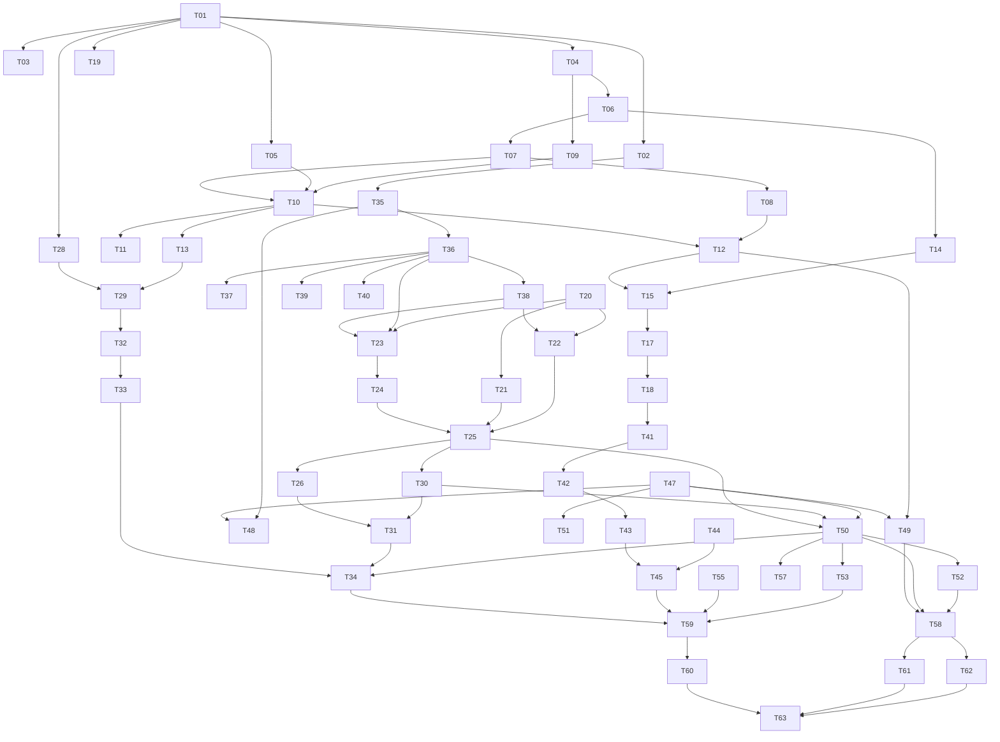

# 11 — Implementation plan: work breakdown, dependencies, schedule, gates, risks

Two developers, **A** (data + evaluation) and **B** (cluster + observability). Every task has an owner for *building*, a dependency list, an estimate, a priority and an acceptance check. Priorities: **P0** = required by an explicit PDF sentence (cannot be cut), **P1** = strongly recommended (removes risk or strengthens a graded answer), **P2** = stretch. Estimates are person-hours for a developer who has read the relevant doc; they are **planning numbers, not measurements** — update them after Gate G1.

Total ≈ **215 person-hours** (≈ 105 h each). The A2 harness's critical path was 58 h of *sequential* work; the A3 critical path is dominated by **machine time** (CPU LLM runs) — see §4.

---

## 1. Before you start (T01)

* **Deadline (told by the group on 22 Nov 2026): 5 days away ⇒ about Fri 27 Nov 2026.** Confirm the exact date and time on Google Classroom and write it here: `DEADLINE = ____________ (PKT)`. The PDF does not state it and "late submissions will receive zero marks". **Because only 5 days remain, use the full-scope overtime plan in §5a, not the 14-day skeleton in §5.**
* Convert the schedule in §5 to calendar dates: count back from the deadline, keep **the last 2 days free** (report polishing, rehearsal, final clean-cluster run).
* With fewer than 10 working days left, **do not cut requirements** (decision of 22 Nov): follow §5a, work overtime, and only postpone the *extras* listed in §7.
* Send the open questions of [01](01-REQUIREMENTS.md) §9 (Q1 quarantine vs archive for stale versions; Q2 disjoint golden counts; Q3 typo vs distractor docs) to the instructor/TA **on day 1**; proceed with the adopted readings meanwhile.
* Create the evidence folder `docs/a3-evidence/` and the branch `dev` working discipline from A2 (protected `main`, PRs, one approval).

---

## 2. Work breakdown (T01–T63)

Legend for requirement IDs: see [01](01-REQUIREMENTS.md). "Acceptance" is what a reviewer runs/sees to mark the task **DONE**.

### Phase 0 — foundations

| ID | Task | Own | Depends | h | P | Acceptance | Closes |
|---|---|---|---|---|---|---|---|
| T01 | Deadline, open questions, branch plan, `docs/a3-evidence/`, swap-review pairing | A+B | — | 1 | P0 | file §1 filled; questions sent | G-05 |
| T02 | Skeleton: `ragops/` package (`suite/ gate/ trace/ coverage/ config/`), `rahbar-ragops` Dockerfile + requirements, Makefile targets, add package to ruff/mypy/pytest and CI | B | T01 | 3 | P0 | `make lint test` green with an empty test; image builds; `minikube image load` works | G-02 |
| T03 | Shared **embed profiles** module (doc/query prefix, lowercase) used by indexer **and** API; tests that both sides agree per model | A | T01 | 2 | P1 | unit tests; A2 tests still green | C1 |

### Phase 1 — Part A: data management (A) — [05](05-DATA-MANAGEMENT.md)

| ID | Task | Own | Depends | h | P | Acceptance | Closes |
|---|---|---|---|---|---|---|---|
| T04 | Data lake layout, **ledger** (schema 14 §2), lock, atomic writes, corpus-state digest | A | T01 | 5 | P0 | tests: atomic write, corrupt → exit 3, lock contention | F1-04, A2 |
| T05 | **Spike:** against the cluster's Chroma 1.0.12 confirm `upsert`, `delete(where)`, `update(metadatas)`, `get(include=embeddings)`, registry `modify()`; decide fallback if any fails | A | T01 | 2 | **P0 (blocks T10)** | one-page result in `docs/a3-evidence/chroma-spike.md` | A2 |
| T06 | **Catalog + metadata resolution** (catalog > embedded > derived), series/`doc_id`, `batch` tag, `pipeline.seed`, extend `corpus/sources.yaml` with `doc_id` | A | T04 | 4 | P0 | tests incl. unseen-file cases; A2 corpus resolves 9 docs | A1-04, G-12 |
| T07 | **Verification** (`verify.py`): quality, completeness (weighted truncation), recency, uniqueness (hash + doc-vector cosine + Jaccard) with all four checks recorded per doc; **calibration** (thresholds + near-dup matrix + word-list) | A | T06 | 8 | P0 | tests per rule; `docs/a3-evidence/verify-calibration.md`, `near-dup-matrix.md`; Batch A → 0 quarantined | A1-02…06 |
| T08 | Verification **report** writer (JSON + terminal-sized MD) | A | T07 | 2 | P0 | sample report renders in an 80–120 col terminal | A1-08 |
| T09 | **Quarantine/archive** operations in `lake.py` (+ reason sidecar, repeat detection) | A | T04 | 2 | P0 | tests; files appear as 05 §8 | A1-07, A2-04 |
| T10 | **Incremental reconcile + store**: in-place add/delete/flip, chunk snapshots, registry **revision bump**, self-heal, counters, embed-before-delete ordering | A | T05, T07, T09 | 8 | P0 | tests: unchanged ⇒ embed fake **never called**; changed ⇒ only own ids; crash-resume | A2-01, A2-02 |
| T11 | `ops`: `restore`, `delete`, `count` (orphans), `status`, `unregister` | A | T10 | 4 | P0 | tests; orphan proof output | A2-03, A2-05 |
| T12 | `run.py sync` orchestrator, summary line, exit codes, Job wrapper (1→0) | A | T10, T08 | 3 | P0 | `python -m pipeline.run sync` end-to-end on a local inbox | F2-01 |
| T13 | **Registered indexes**: `build-index` (candidate from lake) + `sync` maintains every registered index | A | T10, T03 | 4 | P1 | candidate collection built; later `sync` updates both | F3-01 |
| T14 | **Batch B** (12 files) + `corpus/batch-b/README.md` stating the planted problem and expected result per file | A | T06 | 4 | P0 | listing; each file's expected outcome written **before** running | A-B-* |
| T15 | Run Batch A then Batch B through `sync` against a port-forwarded cluster Chroma; save reports | A | T12, T14 | 3 | P0 | verification reports for A and B; counts; all planted problems handled as designed or discrepancies logged | A-B-08 |
| T16 | Part A review + PR hardening (cross-review by B); update `tests/test_boundaries.py` (14 §10) | B | T15 | 2 | P0 | PR approved | — |

### Phase 2 — Part D: observability (B) — [08](08-OBSERVABILITY-TRACING.md) *(start in parallel with Phase 1)*

| ID | Task | Own | Depends | h | P | Acceptance | Closes |
|---|---|---|---|---|---|---|---|
| T35 | `trace.py`: `TraceRecorder`, `StageTimer`, writers (stdout + per-pod file), prompt store, rotation, failure isolation | B | T02 | 4 | P0 | tests: one line per request; unwritable volume doesn't break | D1-01, F4-01/02 |
| T36 | Instrument the answer path (`retrieve_detailed`, `PromptBundle`, stage timers, cache-hit path, decline paths) **without changing answers** | B (+A review) | T35 | 5 | P0 | A2 tests unchanged and green; trace has every PDF field | D1-02 |
| T37 | **Rails** (`rails.py`): retrieval + input rail, actions into the trace, exclusion rule, patterns + false-positive tests on real corpus text | B | T36 | 4 | P0 | tests; counters | D4-01 |
| T38 | **`/api/retrieve`**, eval headers, `trace_id`/`release_id` fields, new Prometheus series | B | T36 | 4 | P0 | tests; curl shows candidates with doc ids | D3-01, B-C |
| T39 | Trace tool `show` (+ prompt-store verification, lake rebuild check) | B | T36, T04 | 4 | P0 | tests incl. tamper/changed-chunk cases | D2-01 |
| T40 | Trace `summary` script (window, distributions, per-stage p95, injection flags) | B | T36 | 3 | P0 | tests; output on sample traces | D3-02 |

### Phase 3 — Part B: offline testing (A) — [06](06-OFFLINE-TESTING.md)

| ID | Task | Own | Depends | h | P | Acceptance | Closes |
|---|---|---|---|---|---|---|---|
| T17 | `golden.py` schema + **validator** + migrate the 19 A2 questions to `(doc,page)` (human step) | A | T15 (page lookup needs the index) | 5 | P0 | `golden --validate` exit 0 on the migrated set (quota table prints) | B-G-* |
| T18 | Write remaining **human** questions, **synthetic** generation + **review of every one**, Batch-B questions (B07/B08/B09 only), freeze v1 (commit + hash) | A+B | T17, T14 | 6 | P0 | ≥ 30 questions; quotas met; frozen commit | B-G-* |
| T19 | `eval/pairs.jsonl` (≥ 15 + ≥ 15, with difficulty) | B | T01 | 2 | P0 | validator | B-M-01 |
| T20 | `metrics.py` (recall, MRR, nDCG, precision, percentiles, κ) | A | T02 | 3 | P0 | worked-example tests (06 §5.3) | B-C-01 |
| T21 | `module_level.py` (gap, ms/chunk, determinism) | A | T20, T03 | 3 | P0 | runs against Ollama | B-M-* |
| T22 | `component_level.py` + typo noise | A | T20, T38 | 4 | P0 | runs against live API; clean vs noisy | B-C-* |
| T23 | `e2e_level.py`: seeded asks, cache bypass assertion, abstention, citation validity, latency, deterministic faithfulness proxy | A | T20, T38, T36 | 4 | P0 | one question end-to-end; trace id retrieved | B-E-01…04 |
| T24 | `judge.py` + hand labels (≥ 8, aim 12) + agreement + κ | A+B | T23 | 4 | P0 | `judge_labels.jsonl`; agreement printed | B-E-05 |
| T25 | `run_suite.py` orchestration, config, result schema, timestamped file, summary table | A | T21, T22, T23, T24 | 4 | P0 | **one command** → file + table (Screenshot B1) | B-1C-01 |
| T26 | `stochasticity.py` + two seeded runs + explanation | A | T25 | 2 | P0 | Δ table | B-S-01 |
| T27 | `suite.diff` tool + baseline promote + pull results to `eval/results/` | A | T25 | 2 | P1 | diff output | E3 |

### Phase 4 — Part C: change, gate, release (A + B) — [07](07-CHANGE-AND-RELEASE.md)

| ID | Task | Own | Depends | h | P | Acceptance | Closes |
|---|---|---|---|---|---|---|---|
| T28 | **Feasibility check** and choose the change; write candidate specs (`baseline`, `bad`, `good`) with **expected** outcomes | A | T03 | 2 | P0 | specs committed; choice written in the report draft | C1-01 |
| T29 | Build candidate collections (bad, good); **calibrate** floors; record `embed_version` | A | T13, T28 | 3 | P0 | collections exist; `status` lists them | F3-01 |
| T30 | `gate.yaml`, `gate.apply`, `gate.promote`, `decision.json`, tests (boundary at limit) | A | T25 | 4 | P0 | tests; exit codes | C2-01/02 |
| T31 | Derive and **commit thresholds before** candidate runs (stochasticity Δ + judge agreement + latency budget) | A | T26, T30 | 1 | P0 | `gate-thresholds.md`; commit time precedes candidate result files | C2-04 |
| T32 | `candidate.yaml` (Deployment+Service), candidate NetworkPolicy, readiness verification | B | T29, T48 | 3 | P0 | candidate Ready; trace shows its collection | F3-01 |
| T33 | `release.sh` (gate-decision precondition, `set env`, `rollout status`, post-check) + `--dry-run` + tests | B | T30, T32 | 3 | P0 | refuses without a decision; dry-run stable | F3-02/03 |
| T34 | **Run the experiment:** baseline, bad, good suites; gate decisions; scenarios S1 (stopped), S2 (released), S3 (bad release + undo + trace); release decision text | A+B | T31, T33, T50 | 6 | P0 | outputs saved; screenshots C1, C2, F5, F6 | C1-02, C2-03, C3, F3-* |

### Phase 5 — Part E: drift and coverage (A) — [09](09-DRIFT-COVERAGE.md)

| ID | Task | Own | Depends | h | P | Acceptance | Closes |
|---|---|---|---|---|---|---|---|
| T41 | `live_queries.jsonl` (≥ 40: ≈ 28/≥ 12), validator, send through the live system once | A+B | T18 | 3 | P0 | validator; traces exist | E1-01 |
| T42 | `coverage.py`: similarity, share, uncovered, **calibration of τ**, exit code, TF-IDF cross-check | A | T41, T03 | 5 | P0 | tests; calibration table committed | E2-01/02, E4-02 |
| T43 | Coverage **before** run + topic grouping | A | T42 | 2 | P0 | Screenshot E1; topic table | E2-03 |
| T44 | **E3 drift:** ingest Batch B (Job), re-run suite with `--batches A,B`, diff, classify changes | A | T34 (or baseline-A done), T15 | 4 | P0 | before/after result files + analysis | E3-01 |
| T45 | **E4:** ≥ 6 new golden questions, re-run coverage and suite | A+B | T43, T44 | 3 | P0 | Screenshot E2; coverage rose | E4-01 |
| T46 | `coverage-job.yaml` (optional K8s run) | B | T42, T50 | 1 | P2 | Job completes | F |

### Phase 6 — Part F: cluster (B) — [10](10-KUBERNETES.md)

| ID | Task | Own | Depends | h | P | Acceptance | Closes |
|---|---|---|---|---|---|---|---|
| T47 | PVCs + `ragops-config`, `ragops-gate`, `ragops-eval-target` ConfigMaps | B | T02 | 2 | P0 | `kubectl get pvc,cm`; kubeconform | F1-04, F2-05 |
| T48 | **API Deployment changes**: release `env`, traces mount, downward API, flags; update `test_manifests.py` assertions deliberately | B | T35, T47 | 3 | P0 | rollout ok; tests updated with rationale | F3, F4-02 |
| T49 | **Ingest Job + CronJob + seed init + wrapper**; retire A2 `indexer`/`reindex`; Makefile/README references | B | T12, T47 | 4 | P0 | Job Complete on a fresh cluster; CronJob listed | F2-01/02 |
| T50 | **Eval Job** (`k8s/eval-job.yaml`), `job_entry.sh`, `rahbar-ragops` image run in-cluster, target ConfigMap, `make eval` | B | T02, T25, T30, T47 | 5 | P0 | Job runs the suite and fails on a failing gate | F2-04 |
| T51 | Loader pod, `job.sh` helper, `make` targets (`ingest`, `restore`, `eval`, `pull-results`, `drop-batch`) | B | T47 | 3 | P0 | `kubectl cp` round trip | G-10 |
| T52 | NetworkPolicies (eval, candidate, loader, edits) + **verification outputs** | B | T50, T32 | 3 | P0 | `nc`/`wget` matrix saved | F2-03 |
| T53 | **Resource measurements** (api, candidate, chroma, ingest, eval, coverage) → manifests | B | T49, T50 | 4 | P0 | table with files in `docs/a3-evidence/top-*.txt`; no OOM on re-run | F5-01 |
| T54 | F4 evidence: `kubectl logs` traces, PVC listing, `port-forward` metrics | B | T48, T38 | 1 | P0 | outputs saved | F4-* |
| T55 | D4 (B08 attack, hostile question) and D5 (root cause) evidence | B+A | T37, T39, T25 | 3 | P0 | trace screenshots; 5-line note | D4-02, D5-01 |
| T56 | Part A evidence **on the cluster** (reports A and B, second run 0 embeds, restore, orphan count) | A | T49, T15 | 2 | P0 | Screenshots A1, A2 | A* |
| T57 | **Threshold-ConfigMap demo** (`MODE=gate`; fail → edit → pass; same image) | B | T50, T30 | 1 | P0 | Screenshot F4 | F2-05 |
| T58 | **Clean-cluster rehearsal** from `minikube delete` using `k8s/README.md` only; fix gaps; write `k8s/README.md` | A+B | T49–T52 | 4 | P0 | stopwatch time recorded; pipeline answers a question | G-15 |

### Phase 7 — report and submission — [12](12-REPORT-AND-EVIDENCE.md), [13](13-DEMO-RUNBOOK.md)

| ID | Task | Own | Depends | h | P | Acceptance | Closes |
|---|---|---|---|---|---|---|---|
| T59 | Report body (≤ 8 pages): both tables, results A–F, release decision, short answers (a)–(f), contributions, AI statement | A+B | T34, T44, T45, T55, T53 | 8 | P0 | PDF ≤ 8 pages | G1–G5 |
| T60 | Screenshot appendix A1…F6, labelled, nothing cropped | A+B | T56, T34, T55, T45 | 4 | P0 | every label in 01 §10 present | G-13 |
| T61 | Root README (command per part A–F), `docs/AI-USAGE.md`, commit-author check, `make check` | A+B | T58 | 3 | P0 | README commands verified from a clean clone | G-11, G-08 |
| T62 | Demo rehearsal ×2 including the **unseen batch** (3 unfamiliar documents) and viva Q&A | A+B | T58 | 3 | P0 | rehearsal log | G-12, G-03 |
| T63 | Final checklist (12 §10), tag, submit; keep the cluster running | A+B | all | 2 | P0 | submitted | G-05 |

Sum: Phase 0 = 6 h · Part A = 50 h · Part D = 24 h · Part B = 39 h · Part C = 22 h · Part E = 18 h · Part F = 35 h · report/submission = 20 h → **≈ 214 h**.

---

## 3. Dependency graph (what blocks what)

**Critical path (longest chain of hand-offs):** `T01 → T05 → T10 → T12 → T15 → T17 → T18 → (freeze) → T25 → T26 → T31 → T34 → T44 → T45 → T59 → T60 → T63`, with **machine-time** inserted at T15 (embedding Batch A/B), T26 (two full suite runs), T29 (candidate builds) and T34 (three suite runs). Everything in Part D and the K8s manifests runs **in parallel** with Part A and feeds T22/T23/T50.

**Safe parallel windows:** (i) T04–T16 (A) ‖ T35–T40 (B) ‖ T47–T49 (B); (ii) T19–T21 can start before the index exists; (iii) T32/T33/T52/T53 (B) while A writes golden/suite code; (iv) T41 (queries) while the suite machine-runs.

**Hard blockers to respect:** T05 before T10 (do not design around an assumption about Chroma); T36+T38 before T22/T23 (suite needs the endpoint, headers, trace id); T15 before T17 (pages come from the real extraction); T31 before T34 (thresholds first).

---

## 4. Machine-time plan (the real constraint)

CPU-only `llama3.2:3b` makes each end-to-end question take tens of seconds to minutes (A2 measured up to ≈ 190 s). Plan machine runs as **calendar items**, not afterthoughts:

| Run | Approx. LLM calls | When | Note |
|---|---|---|---|
| Batch A full build (embeddings only) | 0 LLM | T15 | ~530 chunk embeddings |
| Batch B ingest | 0 LLM | T15/T44 | embeddings only |
| Baseline suite | ≈ 30 asks + ≈ 24 judge | after T25 | overnight if needed |
| Suite run ×2 (stochasticity) | ×2 | T26 | overnight |
| Candidate-bad, candidate-good suites | 2 × (30 + 24) | T34 | each can run overnight; use retrieval-only first to pre-screen |
| E3 re-run (A,B) | 1 × full | T44 | after Batch B is ingested live |
| After-E4 run | only the ≥ 6 new questions (`--only-added E4`) + coverage | T45 | coverage rise is the requirement |
| Rehearsals | 1–2 partial | T62 | use `--limit` |

Total ≈ **8–10 full suite runs** — budget **≥ 10–15 hours** of unattended machine time and protect it (no laptop sleep: `systemd-inhibit` / `caffeinate`; disable suspend; keep Ollama warm). **Pre-screen** candidates with the module and component levels (minutes) before spending hours on the endpoint level.

---

## 5. Schedule skeleton (D = working day; map to dates after T01)

| Day | A (data + evaluation) | B (cluster + observability) | Gate at day end |
|---|---|---|---|
| **D1** | T01, T03, T04, **T05 spike**, start T06 | T01, T02, T47 | **G0** foundations: skeleton green, spike result, deadline known |
| **D2** | T06, T07 (start calibration with real corpus), T09 | T35, T36 (start), T48 | — |
| **D3** | T07 (finish), T08, T10 | T36, T37, T38 | — |
| **D4** | T10, T11, T12, T14 | T38, T39, T40, T49 | **G1** Part A runs locally on Batch A+B; traces and `/api/retrieve` on the cluster |
| **D5** | T13, T15, T17 | T50, T51, T52 | — |
| **D6** | T18 (freeze golden v1), T19, T20, T21 | T50 (finish), T53 (start), T32 prep | **G2** golden frozen; ingest + eval Jobs run on the cluster |
| **D7** | T22, T23, T24 (hand labels with B) | T24, T54, T52 | — |
| **D8** | T25, **start baseline run (overnight)**, T28 | T53, T33 prep | **G3** one-command suite produces a result |
| **D9** | T26 (second run overnight), T29, T30 | T32, T33, T53 | — |
| **D10** | T31 (**commit thresholds**), T34 start (candidate runs overnight) | T34 scenarios | **G4** gate decisions exist |
| **D11** | T41, T42, T43, T44 | T34 (S1–S3), T55 | **G5** release scenarios captured |
| **D12** | T45, T56, T57 | T57, T46, T58 (clean-cluster rehearsal) | **G6** E done, evidence complete |
| **D13** | T59 (draft), T60 | T59, T60, T61 | **G7** report + screenshots + README |
| **D14** | T62 (rehearsal ×2), T63 | T62, T63 | **G8** submitted; cluster left running |

If you have more calendar time, add slack *before* D8 (the first long run) — everything after it depends on the machine.

---

## 5a. Five-day FULL-SCOPE plan (ACTIVE — deadline ≈ Fri 27 Nov 2026)

**Decision (22 Nov, both members): nothing the PDF asks for is dropped, shrunk or "minimum-viable'd".** Every row of [01](01-REQUIREMENTS.md) §2–§7 is delivered at the specification in docs 05–10: golden set **≥ 30** (not the 25 minimum), the **whole suite run twice**, all **four** verification checks with calibration, all **F1–F5** items, **both** gate decisions, **S1, S2 and S3**, every screenshot **A1…F6**, the full report. The team works **overtime** instead. This section only decides *order and parallelism*.

**What is allowed to slip (and only this):** items that are **my additions beyond the PDF**, never PDF requirements — T46 (coverage as a Job), chunk-level embedding reuse (05 §6.2), retrieval/vocabulary coverage (09 §7), the second noise test with distractor documents, the UMAP figure, and the "S3-b live regression" variant (S3-a alone satisfies F3-04). Every other task T01–T45 and T47–T63 is in scope.

### Capacity, honestly
* Hand-coded estimates total ≈ **215 h**. Two people × 5 days × ~13 h ≈ **130 h** of work time. With an AI coding assistant writing tests and boilerplate (you still review and run everything — G-03), the *coding* hours shrink a lot; the hours that do **not** shrink are **machine time** (CPU LLM), **evidence capture**, **cluster debugging** and **review**.
* So the schedule is built around the machine: **never let Ollama sit idle** from Day 4 onward, and **never run two heavy things on it at once** (it corrupts the latency numbers the gate uses — p95).
* **GPU confirmed (22 Nov): the GPU laptop is Taimoor's, not Bilal's.** That machine is therefore the **cluster host**: minikube, host Ollama, every graded run, every screenshot ("from your own cluster and your own runs") and the **demo** happen on it. Consequences: (a) Bilal's laptop is the *development* machine — unit tests, code, docs, review, and a small local minikube with whatever model fits for functional rehearsal — and anything Bilal changes reaches the cluster through Git (PR → pull on Taimoor's laptop → `make images` → `minikube image load`); (b) **both** must be able to drive the cluster at the demo, so Bilal needs remote or in-person hands-on time on Taimoor's laptop (SSH/`tmux` or pair-sit; if remote: `ssh -L` for the Ingress and `kubectl` through the host, or Tailscale) — schedule it, do not assume it; (c) the long runs (Day 4–6) are run **by whoever is sitting at Taimoor's laptop**, with the other reviewing outputs from the committed result files; (d) Bilal also needs one **full rehearsal** of the three demo actions on the GPU laptop; (e) never mix: a result produced on Bilal's CPU laptop must **not** be compared with one from Taimoor's GPU laptop. Run Ollama on the GPU laptop for **every** suite, candidate and rehearsal run. Rules that keep the numbers valid: (1) **one machine, one Ollama configuration** for baseline, candidates and the E3 run — latency p95 is gated, and a change of hardware or of GPU/CPU offload between runs makes baseline and candidate incomparable; record GPU model, driver, Ollama version and `OLLAMA_*` settings in `docs/a3-evidence/host.md` and in every result's notes; (2) the minikube cluster must reach that Ollama (same laptop, or `OLLAMA_HOST=0.0.0.0` plus the NetworkPolicy host IP); (3) the demo laptop should be this machine — if the demo uses a different one, re-measure the demo baseline there; (4) keep runs sequential anyway (two heavy jobs on one GPU still distort latency); (5) the faster runs mean the §5a machine-time table likely shrinks from hours to minutes per suite — **MEASURE the first run and re-plan**, and use the saved time for review and evidence, not for dropping or adding scope.
* Two shifts per day: **Shift 1** (morning → evening) = build; **Shift 2** (evening → night) = review, run, capture evidence, and start the overnight run. Pair on the critical path (T05, T10, T25, T34).

### Live-state discipline (do not skip — it protects the numbers)
The live index must be in **corpus state A** (the nine documents) for the whole of Parts B and C, and receive **Batch B only at E3** — otherwise baseline, candidates and the drift comparison are not comparable. Therefore:
1. **Day 3:** develop and demonstrate Batch B on a **scratch** target (`DATA_DIR`/inbox and collection `rahbar-scratch`, deleted afterwards), including the verification report and quarantine behaviour. This is also your regression rehearsal for the unseen-batch demo.
2. **Live cluster:** seed **Batch A** → first `sync` → **second `sync` (0 embeds, Screenshot A2)** → freeze baselines on state A.
3. **E3 moment (Day 5 night / Day 6 morning):** ingest **Batch B for real** on the live PVC → verification report **A1**, quarantine, supersede/restore, orphan count → re-run the suite `--batches A,B`.
Candidates are built from the lake while it is in state A (T29), so Part C compares like with like.

### Machine-time schedule (the real critical path; one Ollama, one run at a time)
| Slot | Run | Needs | Notes |
|---|---|---|---|
| Day 4 evening | **baseline-A run 1** (full suite, all three levels) | T25 done, golden frozen | becomes the baseline candidate |
| Day 4 night | **baseline-A run 2** (stochasticity, same seed/config) | run 1 finished | diff → thresholds |
| Day 5 morning | module + component **pre-screen** of cand-bad and cand-good (minutes) | T29 | cheap sanity before the long runs |
| Day 5 midday (after **thresholds are committed**, T31) | **cand-bad full suite** | T29–T31 | gate FAIL expected, decided by the gate |
| Day 5 afternoon | **cand-good full suite** | | gate decision; S1/S2/S3 scenarios follow (they need little LLM) |
| Day 5 night | *(machine free for scenario rehearsals / `kubectl top` measurements / demo-profile baseline)* | | resource measurements here, **not** while a suite runs |
| Day 5 late night → Day 6 morning | **E3: ingest Batch B live, then full suite `--batches A,B`** | T44 | the 5th full run |
| Day 6 | E4 coverage re-run (seconds); suite run **restricted to the ≥ 6 new questions** (`--only-added E4`) | T45 | a full re-run is *not* what the PDF asks here — it asks that coverage rises; the restricted run shows the new questions are handled |
Total ≈ **5 full suite runs** (≈ 5–10 h machine time on CPU) plus short runs. This is feasible **only if** the suite works by Day 4 evening — which is why T17–T25 are the top priority on Days 3–4.

### Day-by-day (every task is placed; none removed)
| Day | A (data + evaluation) | B (cluster + observability) | Both | End-of-day gate |
|---|---|---|---|---|
| **D1** Sun 22 | T01 · **T05 Chroma spike** · T04 · T06 · start T14 (author Batch B) | T01 · T02 · T47 · T35 · start T36 | confirm deadline; ask GPU question | skeleton green; spike answered |
| **D2** Mon 23 | T07 (calibration on Batch A **and** the drafted Batch B) · T08 · T09 · start T10 · finish T14 | T36 · T37 · T38 · T48 · T19 (pairs) | review swap | trace + `/api/retrieve` live on cluster; verification works locally |
| **D3** Tue 24 | T10 · T11 · T12 · T13 · T03 · **T15 (Batch B on scratch)** | T39 · T40 · T49 · T50 · T51 (Jobs run on cluster) | **T17 + T18 in the evening: write and review the golden set together; freeze v1** | Batch A on the live cluster, 2nd run = 0 embeds; golden frozen |
| **D4** Wed 25 | T20 · T21 · T22 · T23 · T25 (suite) · T28 · T29 (build candidates; calibrate floors) | T52 (network matrix) · T32 · T33 · T41 (write live queries) · T53 prep | T24 (hand labels, after run 1) | **baseline runs 1 and 2 started/finished overnight** |
| **D5** Thu 26 | T24 · T26 · T27 · T30 · **T31 (commit thresholds first)** · T42 · T43 | T53 (measure while no suite runs) · T54 · T55 · T57 · T34 scenarios S1–S3 | T34 (release decision text) · T56 (Batch A evidence) | gate decisions + release scenarios captured; coverage-before done; E3 started |
| **D6** Fri 27 | T44 · T45 (E3, E4) · T56 (Batch B evidence) | T58 (clean-cluster rehearsal) · T61 | **T59 · T60 · T62 · T63** (report, appendix, rehearsal, submit **before the deadline hour**) | submitted |
If any day's gate is missed, **add hours that night; do not drop a requirement.** If a whole gate is at risk, the *order* of rescue is: (1) call the other member in, (2) re-split tasks across both, (3) ask the instructor/TA about the specific ambiguity, (4) only then reduce a **P2 extra** from the list above.

## 6. Gates (stop-and-verify points)

| Gate | Condition (all must hold) | If it fails |
|---|---|---|
| **G0** | skeleton merged; `make test lint` green; the Chroma spike answered; deadline written; images load into minikube | fix before any feature work |
| **G1** | Batch A → 0 quarantined; Batch B → every planted problem handled **or** deviations logged; unchanged re-run → 0 embeds; trace + `/api/retrieve` live on the cluster | do not start the suite code on a moving ledger/trace contract |
| **G2** | golden v1 **frozen and hashed**; ingest Job completes on the cluster; eval Job runs a `--limit 3` smoke | do not tune anything before the freeze |
| **G3** | one command writes a timestamped result with all three levels; second run diff understood | investigate any retrieval Δ ≠ 0 before continuing |
| **G4** | thresholds committed **before** candidate runs; two decisions exist (one fail, one pass) | if "good" fails honestly, find a better genuine candidate; never relax the gate |
| **G5** | S1, S2, S3 each captured with outputs; trace after undo shows previous collection/embedding | rehearse S3-a again |
| **G6** | E1–E4 numbers exist; PVC survival, network matrix, resources, F4 evidence saved | |
| **G7** | report ≤ 8 pages, tables complete, every number traces to a committed file; screenshot appendix complete | cut prose, never evidence |
| **G8** | clean-clone README test passes; demo rehearsed twice incl. unseen batch; both members explain every part; repo + PDF submitted | |

---

## 7. What may slip (extras only) — requirements are never cut

Nothing in [01](01-REQUIREMENTS.md) §2–§7 may be removed, reduced below its stated minimum, or replaced by a weaker substitute. The only things that may be postponed are **my additions beyond the PDF**, in this order:
1. T46 (coverage as a Job), optional retrieval/vocabulary coverage (09 §7), the UMAP figure.
2. The second noise test with distractor documents (typos satisfy B-C-02).
3. Chunk-level embedding reuse (05 §6.2) — the required behaviour is document-level.
4. The S3-b "live regression" release variant (S3-a satisfies F3-04/F3-05).
5. Extra Table-2 evidence beyond one measured item per quality.
Do **not** shorten: the golden set (stay ≥ 30), the whole-suite-twice stochasticity run, the four checks, the near-duplicate calibration, the threshold-before-candidates rule, any screenshot, the unseen-batch rehearsal.

## 8. Working agreement (two people, one repo)

* **Branches:** `feat/a3-a-Txx-slug`, `feat/a3-b-Txx-slug` off `dev`; PR to `dev`; the **other** person reviews; `main` stays protected (A2 rules; direct push = −4 in A2, keep the habit).
* **Both members must have commits** (G-08): rotate who commits what; check `git shortlog -sn` weekly.
* **Daily 15-minute sync:** what finished, what is blocked, who owns the next machine run, any contract change (14).
* **Contract changes** go to [14](14-INTERFACE-CONTRACTS.md) first, then code; PRs that touch a contract say so.
* **Evidence as you go:** every task that produces a number or a screenshot saves the **raw output** under `docs/a3-evidence/<task>/` the moment it is produced (command, full output, date). Re-creating evidence the night before the deadline is how fabricated-looking evidence happens.
* **Swap-review** so each of you can explain the other's half (G-03).
* **Never claim** a result you have not produced; use `MEASURE`.

---

## 9. Risk register

| # | Risk | L | I | Mitigation | Owner |
|---|---|---|---|---|---|
| R1 | Chroma 1.0.12 lacks/behaves differently for in-place `update`/`modify` | M | H | T05 spike on day 1; fallback = delete+re-add by `doc_id` and keep generation rebuild for registry | A |
| R2 | CPU LLM too slow for repeated suite runs | H | H | `/api/retrieve` for the cheap levels; pre-screen; overnight runs; bounded `num_predict`; protect machine time (§4) | A |
| R3 | A "good" candidate fails the gate honestly | M | M | write expected outcome first; if it fails, report and pick another genuine candidate; never edit thresholds after the fact | A |
| R4 | Candidate embedding model cannot be pulled or is unusably slow | M | M | feasibility check (T28); fallback to chunk-size change (07 §2.1) | A |
| R5 | Verification quarantines real documents (false positives) | M | H | calibrate on Batch A; weights, not single signals; "Batch A = 0 quarantined" acceptance | A |
| R6 | Near-duplicate threshold has no clean gap | M | M | add Jaccard; calibrate on the matrix; document | A |
| R7 | Unseen demo documents break extraction or crash the Job | M | H | graceful failure → quarantine with a reason; rehearse with 3 unfamiliar files; wrapper keeps exit codes sane | A+B |
| R8 | PVC permission/mount problems on first deploy | M | M | `fsGroup`; clean-cluster rehearsal (T58) early (D12 at the latest; try a smoke earlier) | B |
| R9 | Network policies block the new pods | M | M | §7 of 10; matrix test before the demo | B |
| R10 | `rollout undo` does not restore the release values | L (by design) | H | release values in the pod template; rehearse S3 twice | B |
| R11 | Traces from 3+ replicas unreadable/corrupt | L | M | per-pod files; tests | B |
| R12 | Time: deadline closer than assumed | ? | H | T01 first; §5a overtime plan; only §7 extras may slip | both |
| R13 | A2 regressions from the instrumentation | M | H | T36 acceptance = A2 tests unchanged; run the A2 eval before/after | B |
| R14 | Golden labels wrong (page numbers) | M | M | second member verifies every gold page; label fixes in separate commits | A |
| R15 | Demo laptop differs from dev laptop | L | H | rehearse on the demo machine; keep the cluster running; no dependence on internet during the demo | both |
| R16 | Judge (3B) disagrees with humans | H | L | measure and report; gate on the proxy if needed | A |
| R17 | AI-generated content in the report/code not understood by the member | M | H | G-03: each member explains the other's half in rehearsal; AI statement honest | both |
